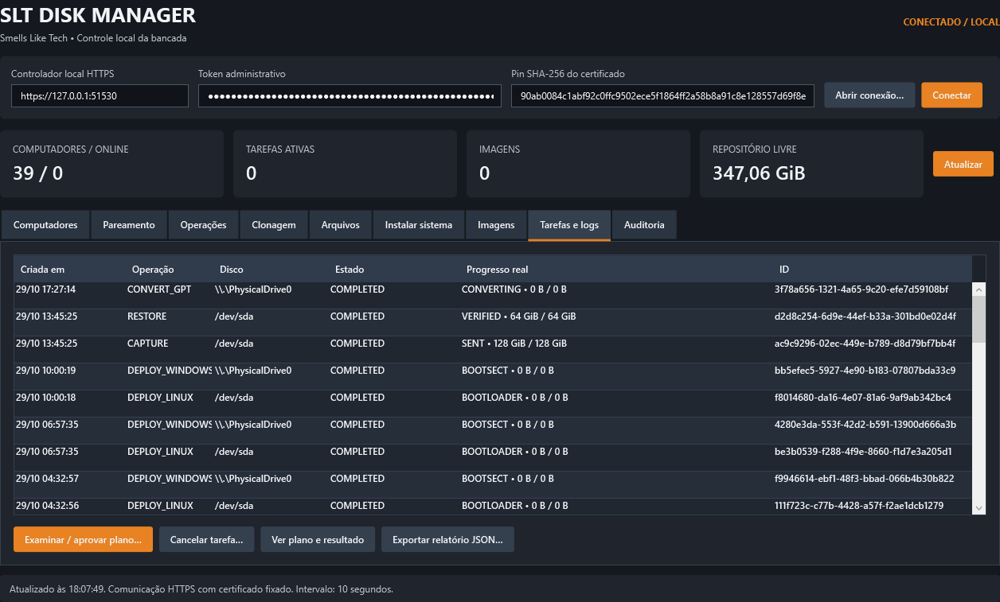
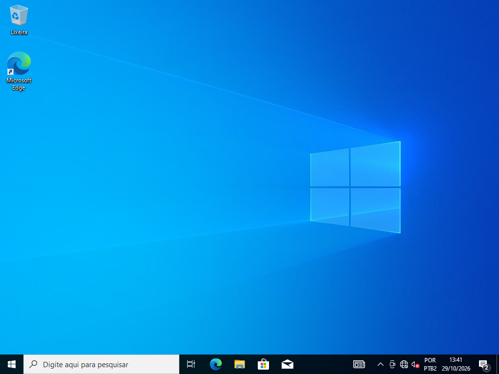
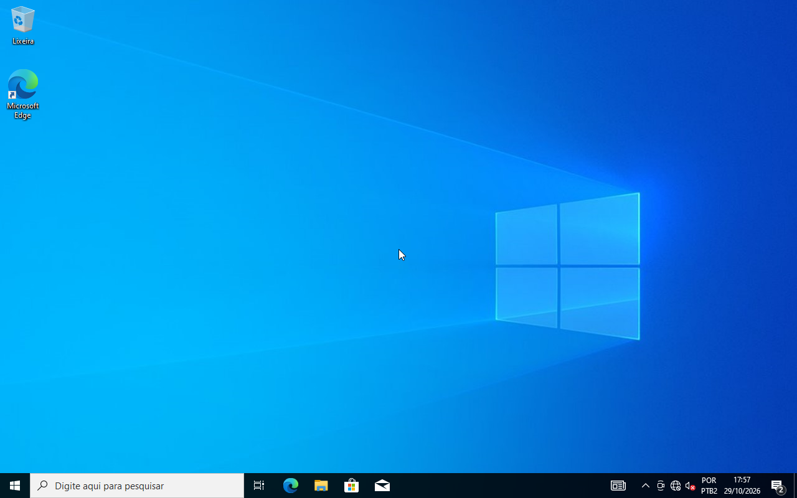
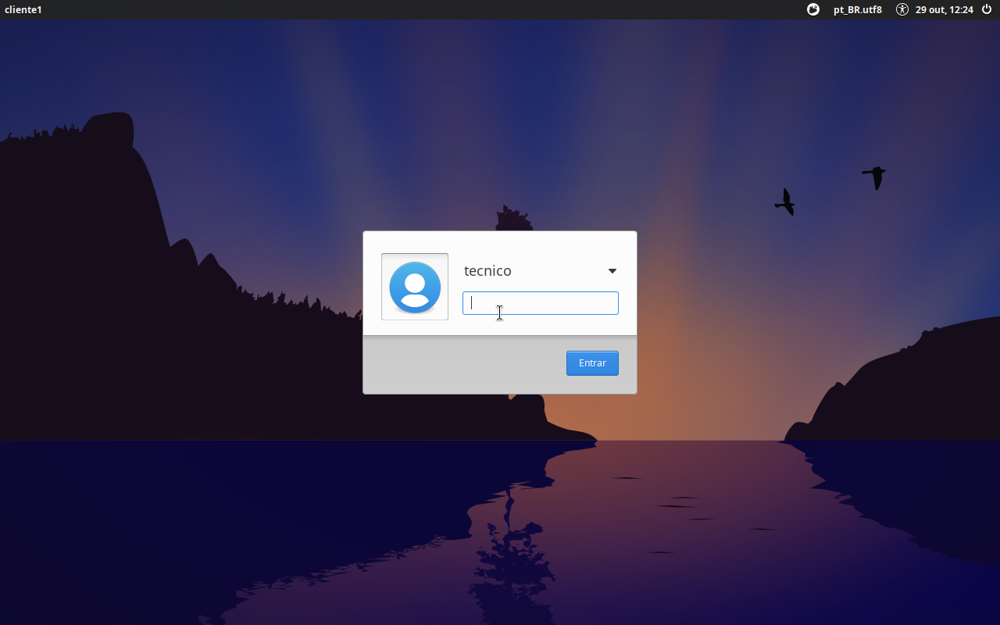
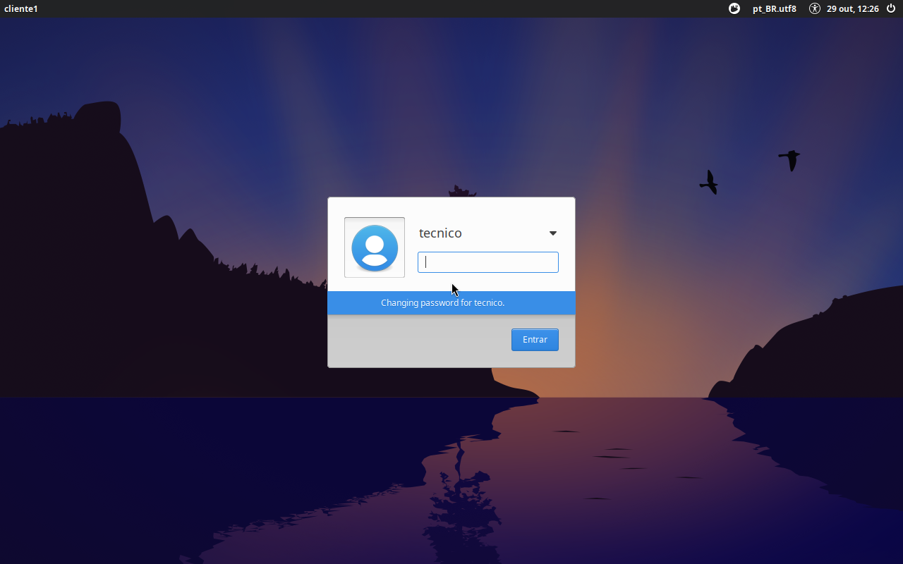

# SLT Disk Manager

Cliente e servidor para bancada de manutenção na LAN, com painel WPF em português,
agente Windows e agente Rescue Linux. Marca: **Smells Like Tech Informática**.

**Versão 0.1.0 beta de laboratório. O produto completo descrito na especificação
ainda não está homologado.** Inventário e diagnóstico são os fluxos indicados para
o primeiro teste em computadores de clientes. Não use gravação de disco em dados
reais antes de homologar o ciclo em VMs e discos descartáveis.

## Novidades da beta.7

- **Conectar sem digitar endereço nem pin.** O cliente encontra o servidor na rede e
  mostra um código de 8 dígitos; o operador digita esse código no painel.
- **Modo SLT.** Um cliente Windows já conectado reinicia no sistema SLT sem pendrive
  (UEFI com Secure Boot desativado) e passa a ser controlado pelo servidor: clonar,
  formatar, capturar, restaurar, instalar Ubuntu/Xubuntu.
- **Formatar disco** pelo painel (NTFS, exFAT, FAT32 ou ext4; GPT ou MBR).
- **Painel redesenhado**: letras maiores, mais contraste e menu lateral.
- **Instalador**: atalhos na área de trabalho, pasta do repositório escolhida na
  instalação, atualização do serviço já instalado e scripts de manutenção.
- **ProxyDHCP opcional** para o boot pela rede sem configurar o roteador.

Decisões e limites em [ADR 003](docs/ADR/003-descoberta-e-pareamento-curto.md) e
[ADR 004](docs/ADR/004-modo-slt-e-proxydhcp.md). O que continua pendente está em
[PENDENCIAS](docs/PENDENCIAS.md).

## Começar

Baixe os instaladores, o pacote portátil, a ISO SLT Rescue e o pacote SLT-Netboot em
[Releases](https://github.com/mikerock12/slt-disk-manager/releases). Siga
[o guia de bancada](docs/QUICKSTART.md).

São dois instaladores: **SLT-Disk-Manager-Servidor-Setup** para o computador da bancada
(servidor, painel, 7-Zip, agentes Rescue/WinPE) e **SLT-Disk-Manager-Cliente-Setup** para os
PCs atendidos (cliente Windows e smartctl). **Fixe o IP do servidor** antes de instalar.

1. No servidor, instale e abra **SLT Disk Manager - Painel** (com o serviço) ou
   **Servidor e painel** (portátil).
2. No computador atendido, abra **SLT Disk Manager - Cliente**: ele procura o servidor e
   mostra um código de 8 dígitos.
3. No painel, digite o código mostrado no cliente.
4. Consulte computadores, discos e partições. Para mexer no disco, use **Reiniciar em
   modo SLT…**, o boot pela rede ou o pendrive SLT Rescue.

O programa funciona sem cloud na operação da bancada. GitHub e Google Drive são
usados apenas no desenvolvimento/backup solicitado pelo proprietário.

## Implementado e verificado

- ASP.NET Core/.NET 10, SQLite local em WAL, painel WPF separado.
- Escuta em IP privado explícito, allowlist CIDR, administração somente loopback.
- Pin SHA256, CSR, certificados individuais, mTLS e revogação imediata.
- Descoberta do servidor na LAN e pareamento por código de 8 dígitos ligado ao
  certificado visto pelo cliente; renovação automática do certificado do cliente.
- Reinício de cliente Windows em modo SLT com ticket de uso único, formatação de
  disco tipada e ProxyDHCP opcional, validados em VMs no laboratório do CI.
- Inventário Windows/Rescue e SMART pelo smartctl 7.5 que acompanha o cliente.
- Plano com consentimento, confirmação contextual, assinatura RSA, validade e ledger anti-replay.
- Captura/restauração RAW offline em chunks de 4 MiB, SHA256, recibos persistidos,
  releitura do destino e clonagem A → imagem verificada → B.
- Assistente de clone integral entre clientes: GPT/MBR, preservação do layout ou
  ajuste NTFS/ext4 para destinos menores/maiores. Por padrão em lotes: o servidor
  guarda no máximo 256 MiB e não precisa de espaço do tamanho do disco.
- Gerenciador de arquivos com escopos locais, backups selecionados, importação
  de pastas do servidor e envio para novas pastas nos clientes.
- Instalação de sistemas: Windows pelo agente WinPE (UEFI/BIOS, sem telas de OOBE,
  conta local com senha temporária gerada pelo servidor) e Xubuntu/Ubuntu pelo Rescue
  (UEFI/GPT, GRUB/shim da própria ISO). Instalações em PCs distintos seguem em paralelo.
- Conversão de disco Windows MBR → GPT/UEFI pelo WinPE com o MBR2GPT da mídia importada.
- Histórico durável, auditoria encadeada, progresso real, cancelamento cooperativo,
  interrupção explícita após reinício sem reexecução automática de escrita.
- Instalador EXE completo (runtime .NET/C++, 7-Zip e smartctl embutidos) que pode
  instalar servidor e cliente como serviços do Windows, além do pacote portátil.

## Telas do teste de laboratório

Teste completo em máquinas virtuais, comandado pelo servidor (detalhes e limites em
[ENTREGA-2026-10-29-beta5](docs/ENTREGA-2026-10-29-beta5.md)): Xubuntu e Windows instalados
ao mesmo tempo, Windows clonado em lotes de 128 GB para 64 GB, disco convertido para GPT/UEFI
e Windows clonado iniciando na área de trabalho.



| Windows 10 instalado pelo servidor (cliente 2, BIOS/MBR) | Windows clonado no cliente 1 após conversão para UEFI/GPT |
|---|---|
|  |  |
| **Xubuntu instalado pelo servidor (cliente 1, UEFI/GPT)** | **Senha temporária exige troca no primeiro login** |
|  |  |

## Limites atuais

Veja [a matriz completa](docs/STATUS.md) e [as pendências](docs/PENDENCIAS.md). Não há
homologação em hardware físico, instalador MSI, assinatura de código nem contas com
permissões por função. O modo SLT exige UEFI sem Secure Boot e não atende BIOS/Legacy.
Instalar Windows ainda exige o cliente WinPE em pendrive. Fora dos perfis de instalação
e da formatação em partição única não há particionador livre. Os scripts locais de
ddrescue/Partclone não equivalem à implementação centralizada desses módulos. O
protocolo v1 usa HTTPS JSON com polling em vez de gRPC (ADR em docs).

## Desenvolvimento

Windows x64, SDK fixado em `global.json`, Go conforme `src/rescue-agent/go.mod`,
Python 3 para testes de integração. Dependências NuGet são restauradas no build;
Go usa apenas biblioteca padrão.

```powershell
./scripts/build.ps1 -Configuration Debug
./scripts/test-all.ps1 -Integration
./scripts/package-release.ps1
```

Os testes de disco usam somente arquivos sintéticos. Testes Windows de inventário
fazem leitura do hardware e podem relatar permissões insuficientes sem elevação.
O CI inclui build, suites de segurança, integração real HTTPS/mTLS e empacotamento.
Consulte [os fluxos da bancada](docs/WORKFLOWS.md) para clone, arquivos e WinPE.

## Trabalho multiagentes

Leia [AGENTS.md](AGENTS.md) e [contexto.md](contexto.md). Ambos devem ser atualizados
ao concluir qualquer tarefa. A especificação original permanece como visão-alvo,
e a matriz de status diferencia código, evidência automatizada e homologação.

Licença comercial ainda não definida; código público não implica concessão de
licença de uso ou redistribuição. Consulte [LICENSE](LICENSE) e [terceiros](docs/12-licensing-third-party.md).
