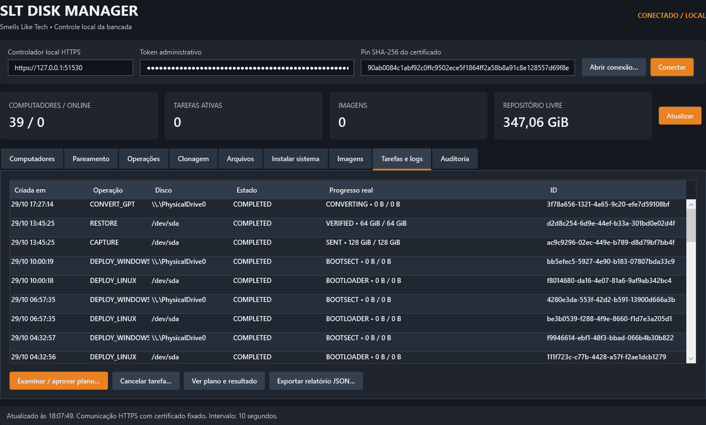
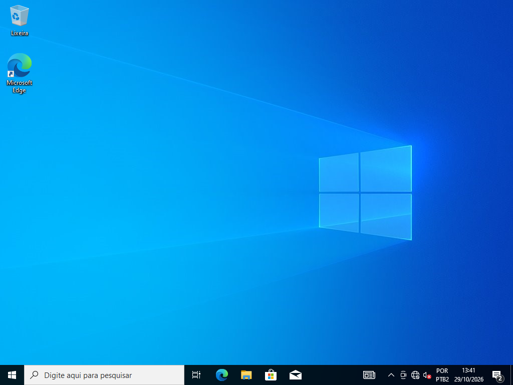
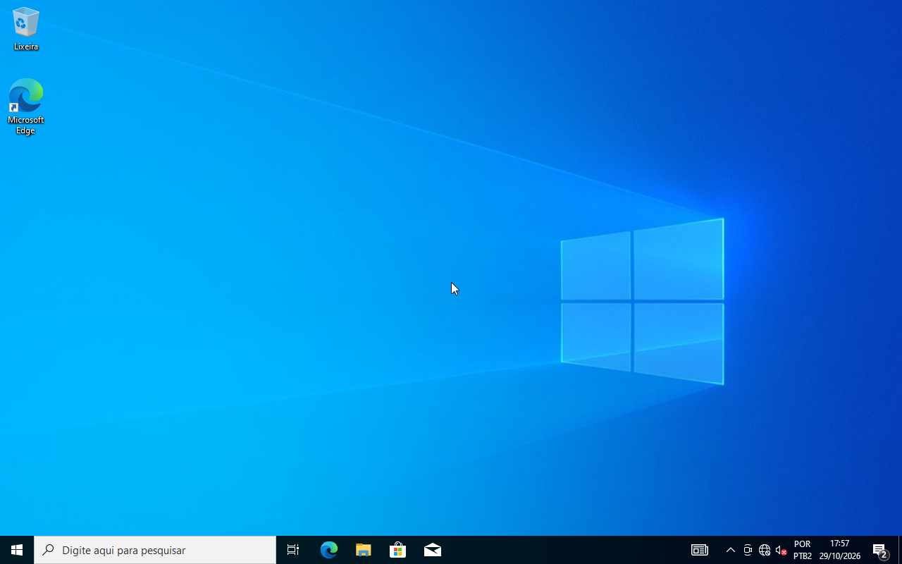
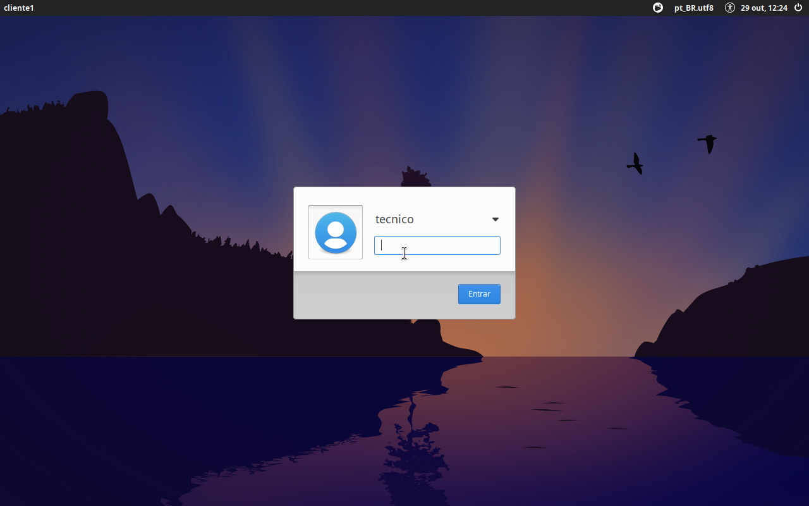
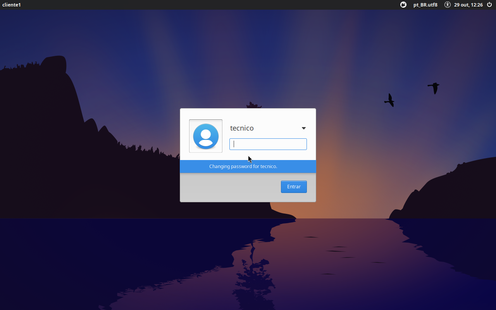

# SLT Disk Manager

Cliente e servidor para bancada de manutenção na LAN, com painel WPF em português,
agente Windows e agente Rescue Linux. Marca: **Smells Like Tech Informática**.

**Versão 0.1.0 beta de laboratório. O produto completo descrito na especificação
ainda não está homologado.** Inventário e diagnóstico são os fluxos indicados para
o primeiro teste em computadores de clientes. Não use a restauração física em
dados reais antes de homologar o ciclo em VMs e discos descartáveis.

## Começar

Baixe os [instaladores do servidor e do cliente, o pacote portátil e a ISO SLT Rescue da beta.5.1](https://github.com/mikerock12/slt-disk-manager/releases/tag/v0.1.0-beta.5.1).
Consulte [a entrega, as evidências de laboratório e os hashes](docs/ENTREGA-2026-10-29-beta5.md).

São dois instaladores: **SLT-Disk-Manager-Servidor-Setup** para o computador da bancada
(servidor, painel, 7-Zip, agentes Rescue/WinPE) e **SLT-Disk-Manager-Cliente-Setup** para os
PCs atendidos (cliente Windows e smartctl). **Fixe o IP do servidor** antes de instalar
(reserva de DHCP no roteador ou IP manual), como explica [o guia de bancada](docs/QUICKSTART.md).
O pacote portátil Windows x64 contém servidor, painel e cliente com runtime .NET incluído.
Após extrair:

1. No servidor, execute `Servidor.cmd` e informe IP/sub-rede da bancada.
2. Nos clientes autorizados, execute `Cliente.cmd`, informe URL e pin SHA256 do servidor.
3. No painel, confira o código exibido fisicamente no cliente e aprove o pareamento.
4. Consulte máquinas, discos, partições, tarefas e relatórios. Para imagem offline,
   use Linux Rescue conforme [as instruções](rescue/README.md).

O programa funciona sem cloud na operação da bancada. GitHub e Google Drive são
usados apenas no desenvolvimento/backup solicitado pelo proprietário.

## Implementado e verificado

- ASP.NET Core/.NET 10, SQLite local em WAL, painel WPF separado.
- Escuta em IP privado explícito, allowlist CIDR, administração somente loopback.
- Pin SHA256, CSR, certificados individuais, mTLS e revogação imediata.
- Inventário Windows/Rescue e SMART pelo smartctl 7.5 que acompanha o cliente.
- Plano com consentimento, confirmação contextual, assinatura RSA, validade e ledger anti-replay.
- Captura/restauração RAW offline em chunks de 4 MiB, SHA256, recibos persistidos,
  releitura do destino e clonagem A → imagem verificada → B.
- Assistente de clone integral entre clientes: GPT/MBR, preservação do layout ou
  ajuste NTFS/ext4 para destinos menores/maiores. Por padrão em lotes: o servidor
  guarda no máximo 256 MiB e não precisa de espaço do tamanho do disco.
- Gerenciador de arquivos com escopos locais, backups selecionados, importação
  de pastas do servidor e envio para novas pastas nos clientes.
- Instalação de sistemas: Windows pelo agente WinPE (UEFI/BIOS, sem telas de OOBE,
  conta local com senha temporária gerada pelo servidor) e Xubuntu/Ubuntu pelo Rescue
  (UEFI/GPT, GRUB/shim da própria ISO). Instalações em PCs distintos seguem em paralelo.
- Conversão de disco Windows MBR → GPT/UEFI pelo WinPE com o MBR2GPT da mídia importada.
- Histórico durável, auditoria encadeada, progresso real, cancelamento cooperativo,
  interrupção explícita após reinício sem reexecução automática de escrita.
- Instalador EXE completo (runtime .NET/C++, 7-Zip e smartctl embutidos) que pode
  instalar servidor e cliente como serviços do Windows, além do pacote portátil.

## Telas do teste de laboratório

Teste completo em máquinas virtuais, comandado pelo servidor (detalhes e limites em
[ENTREGA-2026-10-29-beta5](docs/ENTREGA-2026-10-29-beta5.md)): Xubuntu e Windows instalados
ao mesmo tempo, Windows clonado em lotes de 128 GB para 64 GB, disco convertido para GPT/UEFI
e Windows clonado iniciando na área de trabalho.



| Windows 10 instalado pelo servidor (cliente 2, BIOS/MBR) | Windows clonado no cliente 1 após conversão para UEFI/GPT |
|---|---|
|  |  |
| **Xubuntu instalado pelo servidor (cliente 1, UEFI/GPT)** | **Senha temporária exige troca no primeiro login** |
|  |  |

## Limites atuais

Veja [a matriz completa](docs/STATUS.md). Não há instalador MSI/assinatura de código,
ISO Rescue já homologada em hardware, boot remoto automático, PXE nem RBAC multiusuário.
O particionamento só é oferecido pelos perfis de instalação (Windows no WinPE, Linux no
Rescue), com confirmação no painel e no teclado do destino.
Há scripts locais de aquisição ddrescue/Partclone e orientações de implantação;
eles não equivalem à implementação centralizada desses módulos. O protocolo v1
usa HTTPS JSON com polling em vez de gRPC (ADR em docs).

## Desenvolvimento

Windows x64, SDK fixado em `global.json`, Go conforme `src/rescue-agent/go.mod`,
Python 3 para testes de integração. Dependências NuGet são restauradas no build;
Go usa apenas biblioteca padrão.

```powershell
./scripts/build.ps1 -Configuration Debug
./scripts/test-all.ps1 -Integration
./scripts/package-release.ps1
```

Os testes de disco usam somente arquivos sintéticos. Testes Windows de inventário
fazem leitura do hardware e podem relatar permissões insuficientes sem elevação.
O CI inclui build, suites de segurança, integração real HTTPS/mTLS e empacotamento.
Consulte [os fluxos da bancada](docs/WORKFLOWS.md) para clone, arquivos e WinPE.

## Trabalho multiagentes

Leia [AGENTS.md](AGENTS.md) e [contexto.md](contexto.md). Ambos devem ser atualizados
ao concluir qualquer tarefa. A especificação original permanece como visão-alvo,
e a matriz de status diferencia código, evidência automatizada e homologação.

Licença comercial ainda não definida; código público não implica concessão de
licença de uso ou redistribuição. Consulte [LICENSE](LICENSE) e [terceiros](docs/12-licensing-third-party.md).
