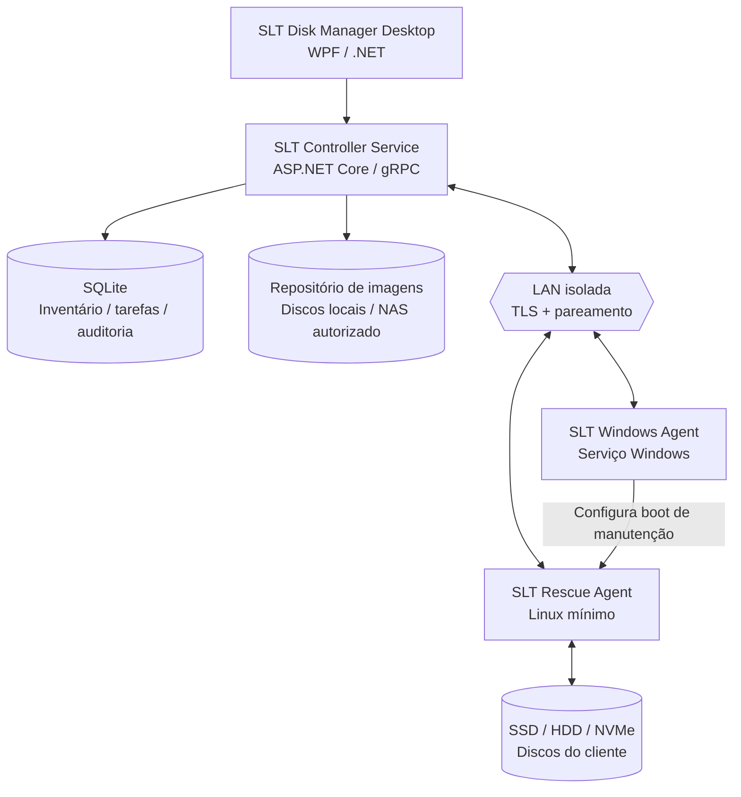
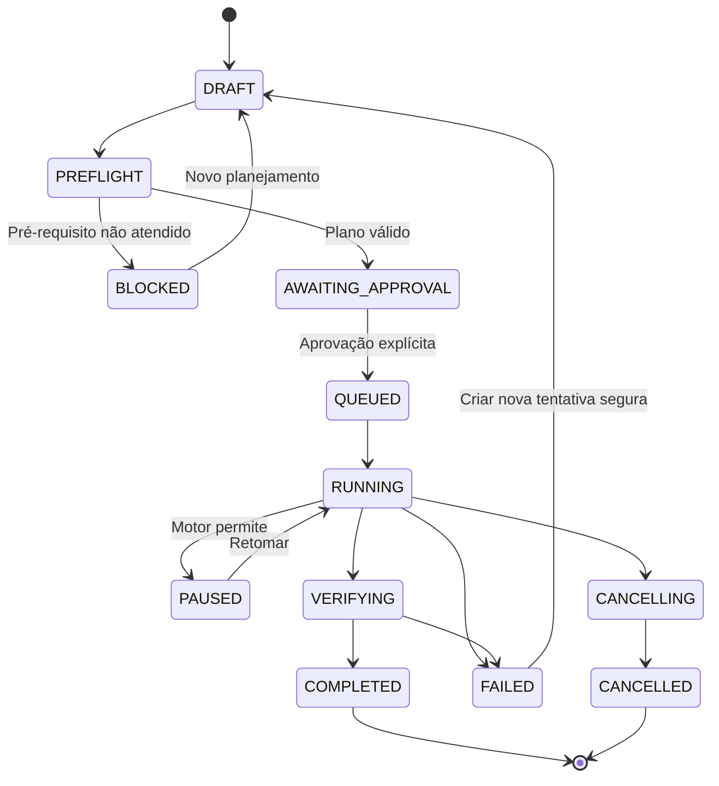

# SLT DISK MANAGER

> **Documento mestre de arquitetura, requisitos e plano de implementação**  
> Projeto: **SLT Disk Manager** — Plataforma de diagnóstico, gerenciamento, backup, clonagem, recuperação e implantação de sistemas operacionais pela rede local  
> Organização: **Smells Like Tech Informática**  
> Versão do documento: **1.0.0**  
> Data: **26/10/2026**  
> Status: **Proposta técnica inicial / baseline de desenvolvimento**  
> Plataformas iniciais: **Servidor Windows 10/11 (x64)**; **cliente Windows 10/11 (x64)**; **Rescue Linux x86-64 com suporte a UEFI**  
> Licença do produto: **a definir antes da distribuição comercial**.

---

## 0. Resumo executivo

O **SLT Disk Manager** é uma solução **cliente–servidor restrita à rede local (LAN)** para manutenção de computadores e de seus dispositivos de armazenamento. O técnico instala um **servidor/controlador** em seu computador e **agentes** nas máquinas sob manutenção. Pelo painel central, pode identificar as estações, inspecionar discos, diagnosticar falhas, gerenciar partições e arquivos, executar backups, clonar discos entre computadores e implantar sistemas operacionais.

Para manipular com segurança discos de sistema que estariam em uso, o cliente poderá reiniciar para um **ambiente de manutenção independente do Windows instalado (SLT Rescue)**. Esse ambiente pode apresentar um terminal, mas **não será apenas um `cmd.exe` administrativo**: deverá conter drivers de armazenamento/rede, acesso direto aos dispositivos de bloco e um agente autenticado. As opções estudadas são um Linux mínimo personalizado (padrão recomendado) e, para procedimentos Windows específicos, WinPE/ambiente de instalação licenciado.

**Princípios imutáveis**:

1. **LAN-only:** sem servidor na internet, cloud obrigatória ou função de acesso remoto pela WAN.
2. **Acesso autorizado:** instalação, pareamento e aprovação expressa do operador responsável pelas máquinas.
3. **Segurança destrutiva:** nenhuma formatação, apagamento ou restauração pode ser iniciada sem identificar e confirmar o disco de destino.
4. **Execução local nos agentes:** os comandos de disco são executados no computador que possui o disco; o servidor coordena, supervisiona e armazena dados/imagens.
5. **Observabilidade e recuperação:** logs, progresso, verificação, retomada onde tecnicamente possível e trilhas de auditoria.
6. **Uso de motores maduros:** integrar bibliotecas e ferramentas consolidadas; não inventar código próprio de clonagem de baixo nível na primeira versão.
7. **Compatibilidade consciente:** respeitar BitLocker, Secure Boot, UEFI/Legacy, tamanhos de setor, GPT/MBR, drivers e licenças de sistemas operacionais.

### 0.1 Escopo

**Dentro do projeto**:
- Descoberta, autenticação, inventário e gestão das máquinas na LAN.
- Controle do agente Windows e do agente de recuperação.
- Listagem de discos físicos, volumes e partições; saúde e desempenho do armazenamento.
- Diagnóstico SMART/NVMe; operações de manutenção e verificação.
- Transferência segura de arquivos autorizados e recuperação orientada a imagem.
- Captura e restauração de imagens de discos/partições.
- Clonagem PC→servidor→PC; clonagem PC→PC otimizada posteriormente.
- Preparação de disco e implantação de Windows/Linux com mecanismos suportados.
- Histórico por máquina, dispositivo, tarefa e operador.
- Distribuição do servidor Windows e do agente Windows; produção de mídia Rescue/PXE.

**Fora da v1/MVP**:
- Gerenciamento pela internet, NAT traversal, acesso remoto externo ou SaaS.
- Quebra/desbloqueio de senhas ou criptografia sem credenciais legítimas.
- Recuperação forense garantida ou promessa de restauração de dados irrecuperáveis.
- Implantação universal em todo hardware sem teste de compatibilidade.
- Console de shell remoto irrestrito por padrão.
- Clonagem a quente universal de todo disco em uso.

---

## 1. Objetivos, público e casos de uso

### 1.1 Objetivo principal

Centralizar em uma estação técnica as operações que normalmente exigiriam pendrives, adaptadores USB/SATA, softwares isolados e intervenção em cada computador.

### 1.2 Usuários

- **Administrador da assistência:** configura o servidor, políticas, contas, imagens e certificados.
- **Técnico:** executa diagnósticos, backup, clonagem, instalação e recuperação autorizada.
- **Operador de leitura:** vê estado, inventário, relatórios e logs, sem permissão para modificar discos.
- **Proprietário/responsável da máquina:** autoriza as atividades e o tratamento dos dados, quando aplicável.

### 1.3 Casos de uso essenciais

| ID | Caso de uso | Prioridade | Fase |
|---|---|---|---|
| UC-01 | Detectar clientes conectados na mesma LAN e realizar pareamento | P0 | MVP |
| UC-02 | Consultar discos, partições, capacidade, modelo, serial e saúde | P0 | MVP |
| UC-03 | Reiniciar cliente de Windows para SLT Rescue e reconectar | P0 | MVP |
| UC-04 | Executar testes SMART, leitura e relatório técnico | P0 | MVP |
| UC-05 | Criar imagem completa de disco em armazenamento do servidor | P0 | Fase 2 |
| UC-06 | Validar, catalogar e restaurar imagem para disco de destino | P0 | Fase 2 |
| UC-07 | Clonar PC A para PC B, preservando partições e dados | P0 | Fase 2 |
| UC-08 | Navegar/copiar arquivos de volumes suportados | P1 | Fase 3 |
| UC-09 | Instalar Windows em disco de cliente pelo fluxo de implantação | P1 | Fase 3 |
| UC-10 | Instalar Linux em disco de cliente | P1 | Fase 3 |
| UC-11 | Criar/remover/redimensionar partições e formatar volumes | P1 | Fase 3 |
| UC-12 | Gerar imagem de disco com falhas e retomar salvamento | P1 | Fase 3 |
| UC-13 | Implantar uma mesma imagem em vários clientes | P2 | Fase 4 |
| UC-14 | Executar clonagem direta cliente↔cliente, sem relevo pelo servidor | P2 | Fase 4 |
| UC-15 | Suporte refinado a drivers e correção de boot pós-clonagem | P2 | Fase 4 |
| UC-16 | Histórico integrado a ordens de serviço do SLT Gestão | P2 | Integração |

**P0**: obrigatório para a fase indicada. **P1**: desejável na fase indicada. **P2**: evolução.

---

## 2. Decisões arquiteturais

### ADR-001 — Servidor em Windows e painel WPF
- **Decisão:** serviço ASP.NET Core em .NET LTS + aplicativo WPF separado.
- **Motivo:** integração nativa com Windows, familiaridade com C#, desenvolvimento e implantação simplificados na oficina.
- **Consequência:** servidor/painel v1 são Windows-only. Agentes podem ser multiplataforma.

### ADR-002 — Dois agentes com responsabilidades distintas
- **Agente Windows:** descoberta, inventário não destrutivo, pareamento, comunicação, preparação do Rescue e controle de reinicialização.
- **Agente Rescue Linux:** acesso aos discos offline, clonagem, formatação, leitura de arquivos, recuperação e implantação.
- **Motivo:** Windows em execução bloqueia parte das operações no seu próprio volume de sistema.

### ADR-003 — Linux Rescue personalizado como padrão
- **Decisão:** imagem Linux mínima para USB/partição/PXE, com binário do agente, ferramentas de armazenamento e rede.
- **Motivo:** flexibilidade, integração com Partclone/ddrescue/smartmontools e ausência de dependência de redistribuição do WinPE.
- **Ressalva:** operações Windows específicas podem exigir mídia de instalação ou WinPE devidamente licenciados.

### ADR-004 — Agentes iniciam as conexões
- **Decisão:** clientes abrem sessão de controle autenticada com o servidor, preferencialmente gRPC bidirecional sobre HTTP/2/TLS.
- **Motivo:** evita exigir portas de controle abertas de entrada em cada PC; permite heartbeat, telemetria e distribuição de tarefas.
- **Observação:** transferência de imagens pode utilizar conexões dedicadas com fluxo controlado.

### ADR-005 — Banco de dados apenas no servidor
- **Decisão:** SQLite em disco local do servidor, acesso exclusivo pelo backend e migrações versionadas.
- **Motivo:** instalação simples e consistência; clientes mantêm só estado mínimo de recuperação/sessão.
- **Não fazer:** colocar o arquivo SQLite em compartilhamento SMB ou gravá-lo diretamente pelos clientes.

### ADR-006 — Mecanismos de clone separados por estratégia
- **Imagem de bloco completa:** cópia bit a bit com preservação de layout, incluindo setores não utilizados, quando necessário.
- **Imagem inteligente:** cópia de blocos usados, com motores específicos por sistema de arquivos e armazenamento de metadados/partições.
- **Recuperação de disco danificado:** ddrescue, imagem de destino e mapa de recuperação.
- **Decisão em tempo de execução:** selecionar motor conforme dispositivo, sistema de arquivos, integridade e objetivo.

### ADR-007 — Operações destrutivas nunca executadas implicitamente
- **Decisão:** fluxo de pré-verificação → simulação/plano → confirmação contextual → execução → validação.
- **Motivo:** impedir apagamento de disco errado e evitar ações irreversíveis sem consentimento.

---

## 3. Visão de arquitetura



> A seta Windows Agent → Rescue representa **a transição de boot**, não dois processos necessariamente ativos simultaneamente. O ambiente Rescue é um sistema independente que roda no próprio cliente.

### 3.1 Componentes e responsabilidades

| Componente | Processo | Responsabilidade |
|---|---|---|
| `SLT.Controller` | Serviço Windows / ASP.NET Core | Autenticação, sessões, fila, orquestração, inventário, APIs, políticas, auditoria |
| `SLT.Desktop` | WPF | Interface administrativa, assistentes, confirmações, dashboards e relatórios |
| `SLT.WindowsAgent` | Serviço Windows | Pareamento, heartbeat, inventário, status, preparação de boot e reinicialização |
| `slt-rescue-agent` | Executável Linux (Go) | Manipulação de blocos, clonagem, arquivos, diagnóstico offline, restauração |
| `SLT.RescueBuilder` | Scripts/build | Criação e versionamento da ISO/USB, initramfs e ambiente PXE |
| `SLT.ImageStore` | Módulo servidor | Catálogo, manifests, chunks, upload/download, checksums e retenção |
| `SLT.JobEngine` | Módulo servidor | Agendamento, estados, política de execução, retry e idempotência |
| `SLT.Audit` | Módulo servidor | Registro imutável lógico de decisões, eventos e operações destrutivas |
| `SLT.Shared.Contracts` | Biblioteca .NET / Protobuf | Contratos, mensagens, erros e versionamento do protocolo |

### 3.2 Ambiente e topologia

- Uma **sub-rede local** é a topologia primária; VLANs roteadas podem ser suportadas mediante configuração explícita, mas sem acesso à internet.
- Conexões devem ser aceitas apenas nas **interfaces LAN configuradas**, com firewall e lista de redes permitidas; não utilizar apenas o endereço IP como prova de confiança.
- Descoberta via mDNS ou broadcast autenticado por fluxo posterior de pareamento. Descoberta **não concede acesso**.
- O servidor pode ter várias interfaces, mas deve exigir seleção da interface autorizada.
- Para ambiente isolado ou sem DHCP, oferecer configuração IP estática no Rescue e descoberta manual por endereço.
- Acesso a NAS é opcional e ocorre **pelo servidor**, não por credenciais distribuídas a todos os clientes.

---

## 4. Stack tecnológica proposta

| Camada | Tecnologia inicial | Alternativas / notas |
|---|---|---|
| Backend/controlador | C# / .NET LTS / ASP.NET Core | gRPC, REST administrativo local |
| Desktop | WPF + MVVM | Avalonia no futuro se houver painel multiplataforma |
| Agente Windows | .NET Worker Service | Windows Service instalado com permissões necessárias |
| Agente Rescue | Go | Rust possível; Go simplifica networking/binário único |
| RPC | Protocol Buffers + gRPC mTLS | REST para ações locais/UI; stream para jobs |
| Banco | SQLite + EF Core | Migrações; backup consistente |
| Logging | Serilog (servidor), logs estruturados (Go) | JSONL e exportação de suporte |
| Armazenamento de imagem | Manifest JSON + chunks binários | SHA-256, Zstandard onde apropriado |
| Disco/partições Linux | `lsblk`, `blkid`, `sfdisk`/`sgdisk`, `parted`, `wipefs` | Encapsulados por drivers/adapters testados |
| Diagnóstico | `smartctl`, `nvme-cli`, `badblocks` (quando cabível) | Evitar testes que estressem disco em falha |
| Cópia inteligente | `partclone` | Suporte condicionado ao filesystem |
| Cópia de blocos | `dd`/motor de streaming controlado | Sem assumir que `dd` é adequado para disco defeituoso |
| Recuperação | GNU `ddrescue` | Arquivo mapa obrigatório |
| Arquivos | `mount`, drivers Linux suportados, `rsync`/cópia com hash | Modo somente leitura por padrão |
| Windows deployment | ISO/WIM/ESD autorizadas; DISM/WinPE quando necessário | `wimlib` pode ajudar; boot BCD precisa fluxo comprovado |
| PXE | iPXE + HTTP/TFTP quando apropriado | Depende do firmware/DHCP/rede; recurso opcional |
| Empacotamento | WiX Toolset / instaladores assinados | Agente e servidor separados |
| Testes | xUnit / FluentAssertions; Go testing | VM, discos sintéticos e hardware real de teste |

**Regra:** verificar licenças e obrigações de redistribuição de cada dependência (incluindo GPL), bem como as condições de uso de imagens e ferramentas Microsoft, antes de empacotar comercialmente.

---

## 5. Fluxos operacionais

### 5.1 Instalação e pareamento de uma máquina

1. Técnico instala `SLT.Controller` + `SLT.Desktop` no servidor.
2. Configura endereço/interface LAN, repositório de imagens, usuários e certificado de autoridade local.
3. Instala `SLT.WindowsAgent` no computador autorizado.
4. Agente localiza o servidor por descoberta LAN ou IP manual.
5. Painel exibe solicitação pendente com nome, serial/ID e resumo de hardware.
6. Operador confere fisicamente a máquina e confirma o **código de pareamento de uso único**.
7. Servidor emite certificado de cliente; agente fixa confiança na CA do servidor.
8. Agente inicia sessão segura; o inventário aparece no painel.
9. Se o Rescue estiver preparado, o painel mostra `Pronto para manutenção offline`.

**Identidade:** atribuir `device_id` (UUID) no cadastro; MAC/IP/hostname são atributos mutáveis, não chaves primárias. Identificar os discos por `disk_id` interno e fingerprint composto (serial + modelo + capacidade + topologia), com alertas de colisão/mudança.

### 5.2 Reiniciar para SLT Rescue

```mermaid
sequenceDiagram
    participant T as Técnico / WPF
    participant S as Servidor
    participant W as Agente Windows
    participant R as Rescue Agent
    T->>S: Solicita entrada em Rescue
    S->>W: Preparar boot + token de sessão
    W-->>S: Diagnóstico de prontidão
    S-->>T: Exibe método e riscos
    T->>S: Confirma reinicialização
    S->>W: Reiniciar para ambiente configurado
    W-->>S: Reinicialização iniciada
    Note over W,R: Cliente reinicia; Windows deixa de executar
    R->>S: Reconecta e comprova identidade
    S-->>T: Cliente online em modo Rescue
```

**Métodos de boot (ordem de preferência por viabilidade)**:

- **USB Rescue:** mais confiável para protótipo e recuperação de máquinas sem SO.
- **Partição/entrada local de Rescue:** experiência ideal, mas requer preparação segura de bootloader/UEFI e plano de rollback.
- **PXE/iPXE:** adequado para bancada em lote; requer suporte UEFI/PXE, infraestrutura DHCP/TFTP/HTTP e política de rede.
- **WinPE autorizado:** ferramenta complementar para cenários Windows, respeitando termos de licença.

**Limitação:** não há garantia de reinicialização automática em todo firmware/estado de BitLocker/Secure Boot. Nesses casos, orientar ação local assistida ou boot por USB.

### 5.3 Criar imagem de disco (cliente → servidor)

1. Selecionar cliente, disco de origem e tipo de imagem.
2. Preflight: identidade, saúde, capacidade, setores, mapa de partições, criptografia, espaço e rede.
3. Definir consistência (preferencialmente disco offline via Rescue).
4. Criar `job_id` e reserva de armazenamento no servidor.
5. Gerar manifest provisório e stream em chunks com checkpoints.
6. Processar dados no Rescue com motor adequado (`partclone`, bit a bit ou ddrescue).
7. Transmitir por canal autenticado; usar hashes por chunk e confirmação de persistência.
8. Finalizar manifest, checksums, erros e métricas.
9. Validar imagem conforme nível escolhido (integridade dos chunks e, quando possível, filesystem).
10. Alterar catálogo para `AVAILABLE` **somente após conclusão e validação satisfatória**.

### 5.4 Clonar máquina A para B

**Implementação inicial (mais previsível):**

`PC A → imagem temporária validada no servidor → PC B`

1. A e B conectados em Rescue.
2. Selecionar origem e destino por **máquina + disco**.
3. Servidor calcula compatibilidade: capacidade utilizável, tamanho lógico/físico de setor, tabela de partição, boot, criptografia e filesystem.
4. Exibir diferenças e possíveis consequências para Windows/UEFI/ativação/drivers.
5. Confirmar destruição do destino digitando identificador exclusivo do disco.
6. Capturar a origem, validar a imagem, restaurar no destino.
7. Verificar GPT/MBR, integridade, boot e dimensionamento de partições quando solicitado.
8. Oferecer pós-clonagem com adaptação controlada, sem prometer compatibilidade universal.

**Evolução:** stream diretamente de A para B, com servidor apenas coordenando autorização/telemetria, confirmação criptográfica dos extremos e checkpoint. Não ativar até existir protocolo seguro de recuperação de falha e proteção contra origem/destino trocados.

### 5.5 Restaurar uma imagem

- Exibir origem, data, tamanho lógico e tamanho armazenado, partições, esquema de boot, checksums e status.
- Exigir disco de destino compatível ou uma operação explícita de redimensionamento, quando tecnicamente segura.
- Imagens bit a bit de disco maior **não devem** ser restauradas automaticamente para disco menor.
- Avisar sobre sobrescrita completa, preservar logs e fornecer relatório final.
- Validar por checksums e amostragem/varredura conforme perfil de verificação; diferenciar `transferência íntegra` de `sistema inicializável`.

### 5.6 Recuperar dados de disco com falhas

1. Detectar sinais de risco: SMART crítico, timeouts, setores ilegíveis, quedas de conexão.
2. Recomendar operação **somente leitura na origem**, minimizando ciclos de leitura e escritas.
3. Avaliar se há risco físico que recomende laboratório especializado antes de continuar.
4. Criar imagem usando `ddrescue` com **mapfile persistente** em armazenamento saudável.
5. Permitir pausa e retomada quando o estado e os offsets forem preservados.
6. Trabalhar na imagem resultante, não diretamente sobre o disco comprometido.
7. Relatório com regiões não recuperadas, erros e confiança do resultado.

**Não realizar por padrão:** CHKDSK de reparo, `fsck -y`, testes destrutivos, formatação ou testes de estresse antes da aquisição de dados de uma unidade fisicamente instável.

### 5.7 Instalação de sistema operacional

#### Windows

- Importar mídia/ISO/WIM/ESD **obtida legalmente pelo técnico**; validar assinatura/hash quando disponível.
- Preparar GPT/UEFI como padrão; fluxo Legacy/MBR apenas quando necessário.
- Exibir opções de particionamento, idioma, edição, drivers e configurações de implantação.
- Utilizar ferramentas compatíveis para aplicar imagem de instalação e configurar inicialização (p. ex., componentes oficiais DISM/BCDBoot em ambiente apropriado).
- Para implantar **imagem personalizada em hardware diferente**, prever `Sysprep /generalize` e políticas de licenciamento.
- Não embutir chaves de produto nem contornar ativação.
- Validar primeiro boot e registrar que etapas de configuração do Windows podem continuar localmente.

#### Linux

- Importar ISO/imagem autorizada, escolher layout de disco, bootloader e configuração de sistema.
- Utilizar mecanismo específico da distribuição ou imagens previamente preparadas.
- Validar UEFI, partição ESP, initramfs, UUIDs e conectividade pós-boot.

**Escopo de compatibilidade deve ser homologado por release; não anunciar “qualquer Windows/Linux” antes de testes.**

---

## 6. Módulos de produto

### 6.1 M01 — Descoberta e inventário

- Pesquisa LAN e inclusão por IP manual.
- Heartbeat e estados: `ONLINE_WINDOWS`, `ONLINE_RESCUE`, `REBOOTING`, `OFFLINE`, `ERROR`, `UNTRUSTED`.
- Informações: hostname, fabricante, modelo, motherboard, CPU, RAM, MACs/IPs, firmware, Secure Boot, TPM (quando disponível), tipo de boot, Windows e build, uptime.
- Identificação de mudanças de hardware e advertência quando o disco mudou.
- Etiquetas internas, bancada, cliente/OS e observações.

### 6.2 M02 — Gerenciador de discos

- Discos físicos: fabricante, modelo, serial, firmware, barramento, interface, capacidade real, setor lógico/físico, removível, leitura apenas.
- Tabelas GPT/MBR; volumes/partições; offsets, alinhamento, UUID/PARTUUID, filesystem, ocupação e flags.
- Ações com suporte explicitamente detectado: montar, desmontar, leitura de arquivos, criar/apagar partição, formatar, ajustar label, preparar GPT.
- Política: **modo leitura como padrão**; gravação liberada somente por tarefa autorizada.
- Operações por lotes com preview e diff da tabela de partições.
- Exclusão segura/secure erase fica fora do MVP; somente após homologação por protocolo/dispositivo.

### 6.3 M03 — Saúde e diagnóstico

- Dados SMART ATA/SATA; NVMe SMART/health; temperatura, horas ligadas, mídia usada, erros e desgaste quando reportados.
- Indicadores separados de `saúde informada pelo firmware`, `resultado de teste` e `alertas observados`.
- Testes de leitura não destrutivos quando apropriados.
- SMART short/extended sob demanda, com estimativas apenas se fornecidas pela ferramenta.
- Relatório exportável JSON/HTML/PDF em fase futura.
- Em dispositivos instáveis: avisos para priorizar imagem de recuperação.

### 6.4 M04 — Imagens e backup

- Perfil **raw** (setores completos) e **inteligente** (blocos utilizados).
- Catálogo por origem, tamanho, data, formato, integridade, armazenamento e retenção.
- Compressão opcional Zstandard, chunks e hash SHA-256; deduplicação fica para fase posterior.
- Captura/restauração com checksums e checkpoint por chunk quando possível.
- Suporte a imagem de partição, disco completo e metadados GPT/MBR.
- Manifest padronizado, versionamento e mecanismo de migração futura.

### 6.5 M05 — Clonagem e implantação

- PC→imagem, imagem→PC, PC→PC via servidor.
- Diferenças entre **clone exato** (layout inalterado) e **migração adaptada** (redimensionamento/ajuste consciente).
- Pré-análise de compatibilidade e definição de estratégia.
- Implantação múltipla com filas e limite de concorrência/banda.
- Acompanhamento de progresso por fase, não apenas percentual fictício.

### 6.6 M06 — Explorador e recuperação de arquivos

- Listar volumes reconhecidos, montar em modo leitura, navegar, pesquisar e copiar para repositório.
- Fluxo upload/download com preservação de datas e checksums quando possível.
- Política de permissões e autorização por escopo; privacidade de dados de clientes.
- Montagem escrita apenas com confirmação adicional.
- Volumes BitLocker/LUKS: solicitar **senha/chave de recuperação legítima**, nunca tentar contornar proteção.
- Filesystems não suportados: exibir limitação; não montar forçadamente em modo escrita.

### 6.7 M07 — Instalação de SO

- Biblioteca de imagens/mídias e metadados.
- Assistente de instalação/particionamento; boot UEFI e suporte legado controlado.
- Registro da imagem aplicada, hash, drivers, etapa do boot e logs.
- Perfis de instalação e unattended (somente campos permitidos e política de privacidade).
- Verificação de compatibilidade/arquitetura, espaço e licença.

### 6.8 M08 — Tarefas e auditoria

- Fila de jobs, prioridades, limites globais e por máquina.
- Iniciar, pausar (quando o motor suportar), cancelar, reexecutar e revisar.
- Histórico durável de transições e logs estruturados.
- Permissões por ação (RBAC) e aprovação diferenciada para operações destrutivas.
- Exportação de comprovante técnico com identificação da máquina/disco e resultado.

### 6.9 M09 — Rescue/Boot

- Gerar USB/ISO Rescue assinado/verificado.
- Gerenciamento de método de boot e detecção de pré-requisitos.
- PXE em módulo opcional, com configuração explícita de rede.
- Diagnóstico de drivers, Secure Boot, rede, conectividade e controladoras (inclusive RAID/VMD onde homologado).
- Fallback para boot manual em caso de BIOS/UEFI incompatível.

### 6.10 M10 — Configurações e administração

- Usuários e papéis; alteração de senha; logs de acesso.
- Discos/pastas de repositório; limite de capacidade, retenção e quota.
- Rede/interface, porta, certificados, emissão/revogação e expiração.
- Backup e restauração da configuração/base local.
- Atualizações assinadas e verificação de versões; upgrades compatíveis entre servidor e agentes.

---

## 7. Interface do usuário (desktop)

### 7.1 Navegação

```text
SLT DISK MANAGER
├── Visão Geral
│   ├── Clientes online/offline
│   ├── Tarefas ativas
│   ├── Alertas críticos
│   └── Capacidade do repositório
├── Computadores
│   ├── Lista e pesquisa
│   └── Detalhes do computador
│       ├── Identificação e hardware
│       ├── Discos / partições
│       ├── SMART / diagnósticos
│       ├── Arquivos
│       ├── Modo Rescue
│       └── Histórico / ordens de serviço
├── Discos e Imagens
│   ├── Catálogo de imagens
│   ├── Capturar imagem
│   ├── Restaurar imagem
│   └── Verificar integridade
├── Clonagem
│   ├── Seleção origem/destino
│   ├── Pré-verificação
│   └── Progresso / relatório
├── Instalação de Sistemas
│   ├── Biblioteca de ISOs/WIM
│   ├── Perfis
│   └── Implantação
├── Recuperação de Dados
│   ├── Aquisição com ddrescue
│   └── Explorar imagens
├── Tarefas e Logs
├── Administração
│   ├── Usuários e permissões
│   ├── Pareamento e certificados
│   ├── Servidor e rede
│   ├── Repositório
│   └── Atualizações
└── Ajuda / Diagnóstico de suporte
```

### 7.2 Telas essenciais

| Tela | Componentes | Ações |
|---|---|---|
| Dashboard | cartões de estado, jobs recentes, alertas | abrir máquina/job |
| Clientes | tabela filtrável, modo online, IP, sistema, bancada | parear, renomear, diagnosticar |
| Detalhe da máquina | inventário, discos e partições em árvore | entrar no Rescue, SMART, arquivos |
| Disco | identidade persistente, estado, mapa visual GPT/MBR | capturar, verificar, particionar com confirmação |
| Assistente de clone | origem/destino lado a lado, comparação, plano | validar e confirmar destino |
| Imagens | cartões/tabela, checksum, retenção | capturar, verificar, restaurar |
| Job | fases, progresso, logs, throughput real | pausar/cancelar se suportado |
| Pareamento | pedidos pendentes, código, identidade | aprovar/rejeitar/revogar |
| Configurações | LAN, armazenamento, perfis e permissões | salvar/testar config |

### 7.3 UX para risco de perda de dados

- Destacar **ORIGEM** e **DESTINO** sem depender apenas de cores.
- Mostrar no diálogo irreversível: nome do PC, serial/modelo/capacidade do disco de destino e partições que serão removidas.
- Exigir digitação de identificador exibido na própria tela (ex.: últimos caracteres do serial + nome do PC).
- Confirmar se o destino contém arquivos; oferecer opção de backup antes.
- Bloquear execução ao detectar `source_disk_id == target_disk_id`, disco de sistema do servidor ou identidade ambígua.
- Não executar tarefas destrutivas via duplo clique ou simples Enter.

---

## 8. Modelo de dados (SQLite)

### 8.1 Entidades

| Tabela | Campos centrais | Observações |
|---|---|---|
| `users` | `id`, `username`, `password_hash`, `role_id`, `enabled`, `created_at` | Hash moderno, sem senhas em texto puro |
| `roles` | `id`, `name`, `permissions_json` | RBAC mínimo: admin, technician, viewer |
| `devices` | `id`, `display_name`, `hostname`, `owner_ref`, `mode`, `trust_status`, `last_seen_at` | UUID; não usar MAC como PK |
| `device_network` | `id`, `device_id`, `mac`, `ip`, `interface_name`, `last_seen_at` | Endereços variam |
| `agent_credentials` | `id`, `device_id`, `agent_mode`, `cert_fingerprint`, `issued_at`, `expires_at`, `revoked_at` | Diferenciar credenciais Windows/Rescue |
| `hardware_snapshots` | `id`, `device_id`, `captured_at`, `json` | Histórico de mudanças |
| `disks` | `id`, `device_id`, `hardware_fingerprint`, `model`, `serial`, `bus`, `size_bytes`, `logical_sector_size`, `physical_sector_size`, `last_seen_at` | Validar fingerprint antes de gravação |
| `partitions` | `id`, `disk_id`, `partition_guid`, `start_lba`, `length_lba`, `filesystem`, `label`, `flags_json` | Snapshot, não presumir imutabilidade |
| `health_reports` | `id`, `disk_id`, `captured_at`, `status`, `raw_json`, `warnings_json` | Evidências SMART/NVMe |
| `images` | `id`, `name`, `source_device_id`, `source_disk_id`, `format`, `logical_size_bytes`, `stored_size_bytes`, `state`, `manifest_path`, `created_at` | `state`: creating/validating/available/failed |
| `image_chunks` | `id`, `image_id`, `sequence`, `offset_bytes`, `size_bytes`, `sha256`, `storage_key` | Granularidade ajustável |
| `jobs` | `id`, `type`, `state`, `created_by`, `source_device_id`, `target_device_id`, `created_at`, `started_at`, `finished_at`, `plan_json`, `progress_json`, `result_json` | Evitar dupla execução |
| `job_steps` | `id`, `job_id`, `sequence`, `type`, `state`, `checkpoint_json` | Etapas duráveis |
| `job_events` | `id`, `job_id`, `timestamp`, `level`, `code`, `message`, `details_json` | Logs/eventos da tarefa |
| `approvals` | `id`, `job_id`, `operator_id`, `target_disk_fingerprint`, `approval_challenge`, `approved_at` | Evidência de confirmação |
| `audit_events` | `id`, `timestamp`, `actor_id`, `device_id`, `action`, `outcome`, `details_json`, `previous_hash`, `event_hash` | Encadeamento antialteração casual; não substitui WORM |
| `media_library` | `id`, `name`, `os_family`, `version`, `architecture`, `sha256`, `local_path`, `license_note` | Só mídias autorizadas |
| `settings` | `key`, `value_json`, `updated_at` | Segredos em cofre/DPAPI, não aqui em claro |

### 8.2 Regras de persistência

- Chaves primárias UUID/ULID, horários armazenados em UTC (UI apresenta hora local).
- `PRAGMA foreign_keys=ON`, WAL, migrações transacionais, backup consistente do banco.
- Dados de recuperação/arquivo grandes não são BLOB no SQLite: ficam no repositório externo e são referenciados pelo banco.
- Registro de auditoria deve preservar **quem, quando, qual máquina, qual disco e qual plano**.
- Logs de arquivos de clientes não devem registrar desnecessariamente nomes, conteúdo e dados pessoais.
- Retenção e descarte devem ser configuráveis em conformidade com política de atendimento/LGPD.

---

## 9. Contratos e API

### 9.1 Canais

- **UI → servidor:** API local autenticada (HTTP/HTTPS), chamada pelo WPF; não expor endpoints administrativos externamente sem necessidade.
- **Agentes → servidor:** conexão iniciada pelo agente, com mTLS após pareamento e protocolo versionado.
- **Fluxo de imagem:** conexão dedicada TLS, autorização por `job_id`, backpressure e transmissão de chunks com hash.
- **Descoberta:** mensagens mínimas; sem execução de comandos no canal de descoberta.

### 9.2 Endpoints administrativos exemplificativos

> Nomes são contratos propostos; não representam implementação já existente.

```text
GET    /api/v1/devices
GET    /api/v1/devices/{deviceId}
GET    /api/v1/devices/{deviceId}/disks
GET    /api/v1/disks/{diskId}/health
POST   /api/v1/enrollment/approvals
POST   /api/v1/devices/{deviceId}/rescue-boot/prepare
POST   /api/v1/devices/{deviceId}/rescue-boot/confirm
POST   /api/v1/jobs/plan
POST   /api/v1/jobs/{jobId}/approve
POST   /api/v1/jobs/{jobId}/start
GET    /api/v1/jobs/{jobId}
GET    /api/v1/jobs/{jobId}/events
POST   /api/v1/jobs/{jobId}/cancel
GET    /api/v1/images
POST   /api/v1/images/{imageId}/verify
GET    /api/v1/audit
```

### 9.3 RPCs propostas

```proto
syntax = "proto3";
package slt.diskmanager.v1;

service AgentChannel {
  rpc OpenSession(stream AgentMessage) returns (stream ControllerMessage);
}

service ImageTransfer {
  rpc Upload(stream ImageChunk) returns (TransferReceipt);
  rpc Download(DownloadRequest) returns (stream ImageChunk);
}

message AgentMessage {
  string device_id = 1;
  string agent_version = 2;
  string agent_mode = 3; // WINDOWS | RESCUE
  oneof payload {
    AgentHeartbeat heartbeat = 10;
    JobProgress progress = 11;
    AgentResult result = 12;
  }
}
message ControllerMessage {
  oneof payload {
    JobAssignment job = 1;
    JobCancellation cancel = 2;
  }
}
message AgentHeartbeat { int64 unix_time = 1; }
message JobAssignment { string job_id = 1; string job_type = 2; bytes signed_plan = 3; }
message JobCancellation { string job_id = 1; }
message JobProgress { string job_id = 1; string phase = 2; uint64 bytes_processed = 3; uint64 bytes_total = 4; }
message AgentResult { string job_id = 1; string status = 2; string error_code = 3; }
message ImageChunk { string job_id = 1; uint64 sequence = 2; uint64 offset = 3; bytes payload = 4; bytes sha256 = 5; }
message TransferReceipt { string job_id = 1; uint64 persisted_bytes = 2; bool complete = 3; }
message DownloadRequest { string job_id = 1; string image_id = 2; uint64 from_sequence = 3; }
```

**Importante:** isto é um **esqueleto ilustrativo**; o contrato final incluirá autenticação, negociação de capacidades, identidades de disco, checksums de manifesto, limites, erros tipados, metadados e controles de fluxo. Não enviar caminhos arbitrários ou comandos shell como substitutos de jobs tipados.

### 9.4 Versionamento e compatibilidade

- API `/v1` e pacote protobuf `slt.diskmanager.v1`.
- Hello/handshake informa `protocol_min`, `protocol_max`, `agent_version`, `capabilities`.
- Servidor bloqueia job se o agente não oferecer capacidade ou versão requeridas.
- Toda tarefa e imagem têm `schema_version`.
- Extensões via campos novos compatíveis; incompatibilidades exigem versão major.

---

## 10. Modelo de tarefas e execução

### 10.1 Máquina de estados



### 10.2 Restrições do scheduler

- No máximo **um job destrutivo ativo por disco físico**.
- Bloquear operações concorrentes que incluam o mesmo volume/dispositivo por caminhos distintos.
- Registrar lease/lock durável com `job_id` e fingerprint.
- `cancel` é **best effort**; cancelar durante escrita pode deixar destino inutilizável. Mostrar claramente.
- A retomada depende do motor e do checkpoint; não prometer retomada de qualquer operação interrompida.
- Deduplicar comandos por `job_id` + `step_id` + `attempt`; proteger contra reenvios de rede após timeout.
- Bandwidth limit, throughput real e número de operações paralelas configuráveis.
- Em queda de conexão, agentes **não iniciam novos passos destrutivos**, aguardam reconciliação e preservam checkpoints.

### 10.3 Pré-verificação (`Preflight`)

Checklist executado e **reexecutado imediatamente antes da escrita**:

- Operador autenticado e com papel adequado.
- Agente emparelhado, com certificado válido, modo correto e versão compatível.
- Máquina e disco identificados de forma inequívoca.
- Estado do disco de origem (leitura) e destino (tamanho, layout, setor lógico/físico).
- Origem e destino são realmente diferentes.
- Disco de destino não é disco do servidor ou repositório de imagem.
- Partições não montadas para escrita, sem operação concorrente conflitante.
- Espaço suficiente e destino de armazenamento gravável.
- Energia estável quando verificação disponível (notebooks preferencialmente na tomada).
- Criptografia do volume identificada; desbloqueio apenas com credenciais autorizadas.
- Layout do sistema e modo UEFI/Legacy compatíveis com operação.
- Imagem de origem validada, completa e em formato conhecido.
- Confirmação contextual ainda válida e vinculada à versão do plano.

---

## 11. Formato de imagem e integridade

### 11.1 Layout no repositório

```text
Repository/
├── images/
│   └── <image-id>/
│       ├── manifest.json
│       ├── partition-table.bin
│       ├── layout.json
│       ├── chunks/
│       │   ├── 00000001.bin.zst
│       │   ├── 00000002.bin.zst
│       │   └── ...
│       ├── verification.json
│       └── recovery-map/       # somente imagens ddrescue
├── incoming/                 # uploads temporários/incompletos
├── media/                    # imagens de instalação autorizadas
├── diagnostics/
└── exports/
```

### 11.2 Manifest (`manifest.json`, exemplo)

```json
{
  "schemaVersion": 1,
  "imageId": "UUID",
  "captureMode": "FULL_DISK_SMART",
  "source": {
    "deviceId": "UUID",
    "diskFingerprint": "hash-do-identificador-de-hardware",
    "logicalSizeBytes": 512110190592,
    "logicalSectorBytes": 512,
    "physicalSectorBytes": 4096,
    "partitionTable": "GPT"
  },
  "engine": {
    "name": "partclone",
    "version": "registrada-em-runtime"
  },
  "chunks": [
    { "seq": 1, "offset": 0, "uncompressedBytes": 1048576, "sha256": "HEX_SHA256", "file": "chunks/00000001.bin.zst" }
  ],
  "state": "AVAILABLE",
  "integrity": { "manifestSha256": "HASH_GERADO_NA_FINALIZACAO", "verifiedAtUtc": null },
  "createdAtUtc": "ISO-8601"
}
```

**Atenção:** o exemplo descreve metadados conceituais; o formato final deverá especificar rigorosamente representação de partições, sparse ranges, offsets físicos, compressão, hashes por chunk, endianness, tool version, resumo criptográfico e regras de atomicidade.

### 11.3 Integridade e recuperação de transferências

- Escrever uploads em `incoming`, persistir chunk, conferir hash e só então acusar recebimento.
- Manifesto final deve ser **imutável/versionado** após promoção para `AVAILABLE`.
- Comprimir somente onde compensa; imagens de dados cifrados normalmente comprimem pouco.
- Na restauração, conferir hash do chunk **antes** de gravá-lo no destino.
- Validar tamanho/capacidade real e geometria antes da primeira escrita.
- Periodicamente executar verificação de integridade do catálogo e avisar sobre imagens corrompidas.
- Criptografia **em repouso** no repositório é configurável e recomendada para dados de clientes; chaves ficam fora do banco em claro.

---

## 12. Segurança e privacidade

### 12.1 Ameaças e controles

| Risco | Controle mínimo |
|---|---|
| Outro dispositivo na LAN tenta assumir identidade | Pareamento físico/visual + certificados cliente + mTLS + revogação |
| Comandos injetados/execução arbitrária | Jobs tipados e whitelisted; validar caminhos e argumentos; sem shell genérico por padrão |
| Dispositivo de destino errado | Fingerprint revalidado, confirmação digitada, locks e verificação pré-escrita |
| Captura de dados na rede | TLS 1.3 quando suportado; mTLS; integridade de chunks |
| Operador sem autorização | RBAC, autenticação local, sessão expirada, auditoria |
| Vazamento de imagem de disco | ACL do repositório, criptografia em repouso, retenção e descarte seguros |
| Rescue adulterado | Hash/assinatura, pipeline de release, mídias oficiais e validação na inicialização quando viável |
| Certificado extraído da partição Rescue | Identidade separada, credencial curta/pareamento específico, TPM2 quando viável, revogação rápida |
| Troca de IP/MAC | Identidade criptográfica estável, não confiar só em DHCP/MAC |
| Perda de energia/rede | Estado durável, checkpoint e retomada seletiva, relatório de destino inconsistente |
| Acesso fora da LAN | Bind em NIC aprovada, firewall, allowlist de redes, sem roteamento externo habilitado pelo produto |

### 12.2 Pairing e credenciais

- CA privada instalada no servidor e protegida com ACL/DPAPI ou armazenamento seguro equivalente.
- Fluxo inicial autenticado e com código temporário de pareamento aprovado no painel.
- Certificados distintos para `WINDOWS_AGENT` e `RESCUE_AGENT` (ou sessão Rescue efêmera vinculada por autorização explícita).
- O estado de aprovação **não** deve ser inferido somente de serial, UUID, MAC ou nome do host.
- Revogação, rotação e validade de certificados; fallback manual seguro para reset de confiança.
- Nunca incorporar uma chave privada global idêntica em todas as ISOs Rescue.
- PXE deve ter fluxo específico de autorização: download público de uma imagem não pode significar controle autorizado.

### 12.3 Proteção de dados e consentimento

- Registrar autorização do proprietário/responsável ou base operacional cabível para acesso, clonagem e transferência de dados.
- Restringir usuários, finalidades e retenção conforme LGPD e contratos de serviço aplicáveis.
- Evitar transmitir ou armazenar conteúdo/nomes de arquivos em logs de rotina.
- Criar política de exclusão/expiração automática de imagens temporárias.
- Não tentar desbloquear BitLocker sem senha, recovery key ou chave válida fornecida legitimamente.
- Prever exportação/remoção de dados de cliente de forma controlada e auditável.

### 12.4 Controles adicionais para ações destrutivas

- Confirmação humana explícita e específica para o disco de destino.
- `signed_plan` contém identificadores, tipo de job, origem, destino, hash de plano, expiração, autorização e nonce.
- Agente revalida o plano e o fingerprint **localmente** antes de abrir o bloco para escrita.
- Nunca confiar cegamente em `/dev/sda`, `Disk 0` ou ordem de enumeração; identificadores podem mudar ao reiniciar.
- Restringir privilégios por subprocesso/capability e nunca expor ferramenta raw com parâmetros vindos diretamente da UI.

---

## 13. Compatibilidade e limitações técnicas

### 13.1 Matriz inicial de suporte (proposta, não homologada)

| Tecnologia | MVP | Futuro | Observações |
|---|---|---|---|
| Windows 10/11 x64 (agente) | Sim | — | Necessário teste de versões e permissões |
| Linux Rescue x86-64 UEFI | Sim | — | Driver de controladora/NIC varia |
| BIOS Legacy | Não obrigatório | Sim | Validar bootloaders específicos |
| SATA HDD/SSD | Sim | — | SMART quando hardware permite |
| NVMe | Sim | — | SMART/NVMe conforme controladora |
| USB externo | Consulta/diagnóstico | Clonagem controlada | Atenção a desconexão e serial ausente |
| GPT/MBR | Leitura | Gravação/transformação | GPT/UEFI como padrão |
| NTFS, FAT32, exFAT | Inventário | Arquivos/clone inteligente conforme motor | Escrita de NTFS exige cuidado |
| ext4 | Inventário | Arquivos/clone inteligente | Suporte conforme ferramenta |
| Btrfs, XFS | Inventário parcial | Validar por filesystem | Sem promessas universais |
| BitLocker | Detectar | Desbloquear com chave legítima | Cópia raw de dados cifrados tem limites |
| LUKS | Detectar | Desbloquear com credenciais legítimas | Sem bypass |
| Intel RST/VMD, RAID | Detectar | Homologar drivers e mapeamento | Nem sempre visível no Rescue |
| Secure Boot | Diagnóstico | Boot Rescue assinado/homologado | Não pedir desativação como solução universal |
| ARM64 | Não | Avaliar | Requer builds e drivers próprios |
| PXE UEFI | Opcional | Sim | Exige ambiente de rede adequado |

### 13.2 Cuidados de clonagem e boot

- **Disco menor:** a capacidade de restauração depende do tamanho efetivo do layout e da ferramenta; jamais truncar partições automaticamente.
- **Setor 512e/4Kn:** diferenças podem impedir restauração simples do layout.
- **UUID/GUID duplicados:** clones simultaneamente ativos na mesma máquina/rede podem causar conflitos; planejar regeneração apenas quando desejada e compatível.
- **Windows em hardware diferente:** drivers, controlador de armazenamento, ativação/licença e preparação de imagem podem interferir no boot.
- **Secure Boot:** verificar assinaturas/cadeia de confiança antes de planejar boot alternativo.
- **BitLocker:** mudanças de boot podem solicitar chave de recuperação; informar antes de preparar Rescue.
- **Snapshots de sistema ativo:** não substituir captura offline por cópia simples de arquivos; suporte a VSS é desenvolvimento separado.

---

## 14. Estrutura de diretórios do repositório (monorepo)

```text
slt-disk-manager/
├── README.md
├── LICENSE                         # definir estratégia de licença
├── CHANGELOG.md
├── CONTRIBUTING.md
├── SECURITY.md
├── .editorconfig
├── .gitignore
├── global.json                      # versão do SDK .NET
├── SLT.DiskManager.sln
├── Directory.Build.props
├── Directory.Packages.props
│
├── docs/
│   ├── 00-vision.md
│   ├── 01-requirements.md
│   ├── 02-architecture.md
│   ├── 03-security-threat-model.md
│   ├── 04-protocol.md
│   ├── 05-image-format.md
│   ├── 06-rescue-boot.md
│   ├── 07-windows-deployment.md
│   ├── 08-linux-deployment.md
│   ├── 09-hardware-compatibility.md
│   ├── 10-testing.md
│   ├── 11-release-operations.md
│   ├── 12-licensing-third-party.md
│   ├── 13-data-protection-lgpd.md
│   ├── ADR/
│   └── diagrams/
│
├── src/
│   ├── server/
│   │   ├── SLT.Controller.Host/
│   │   │   ├── Program.cs
│   │   │   ├── Configuration/
│   │   │   ├── Middleware/
│   │   │   ├── Endpoints/
│   │   │   └── HostedServices/
│   │   ├── SLT.Controller.Application/
│   │   │   ├── Devices/
│   │   │   ├── Disks/
│   │   │   ├── Diagnostics/
│   │   │   ├── Jobs/
│   │   │   ├── Cloning/
│   │   │   ├── Imaging/
│   │   │   ├── Recovery/
│   │   │   ├── Deployment/
│   │   │   ├── Enrollment/
│   │   │   └── Audit/
│   │   ├── SLT.Controller.Domain/
│   │   │   ├── Entities/
│   │   │   ├── ValueObjects/
│   │   │   ├── Policies/
│   │   │   ├── Events/
│   │   │   └── Errors/
│   │   ├── SLT.Controller.Infrastructure/
│   │   │   ├── Persistence/
│   │   │   │   ├── Configurations/
│   │   │   │   ├── Migrations/
│   │   │   │   └── Repositories/
│   │   │   ├── Certificates/
│   │   │   ├── Networking/
│   │   │   ├── ImageStore/
│   │   │   ├── Security/
│   │   │   └── Logging/
│   │   └── SLT.Controller.Grpc/
│   │       ├── Services/
│   │       ├── Mappers/
│   │       └── Interceptors/
│   │
│   ├── desktop/
│   │   └── SLT.Desktop.Wpf/
│   │       ├── App.xaml
│   │       ├── Views/
│   │       │   ├── Dashboard/
│   │       │   ├── Devices/
│   │       │   ├── Disks/
│   │       │   ├── Cloning/
│   │       │   ├── Images/
│   │       │   ├── Recovery/
│   │       │   ├── Deployment/
│   │       │   ├── Jobs/
│   │       │   └── Settings/
│   │       ├── ViewModels/
│   │       ├── Services/
│   │       ├── Controls/
│   │       ├── Converters/
│   │       ├── Themes/
│   │       └── Assets/
│   │
│   ├── windows-agent/
│   │   └── SLT.WindowsAgent/
│   │       ├── Program.cs
│   │       ├── Workers/
│   │       ├── Enrollment/
│   │       ├── Discovery/
│   │       ├── Hardware/
│   │       ├── RescueBoot/
│   │       ├── Security/
│   │       └── Transport/
│   │
│   ├── shared/
│   │   ├── SLT.Contracts/
│   │   ├── SLT.Shared.Security/
│   │   ├── SLT.Shared.Diagnostics/
│   │   └── SLT.Shared.Models/
│   │
│   └── rescue-agent/                # módulo Go separado
│       ├── go.mod
│       ├── cmd/slt-rescue-agent/main.go
│       ├── internal/
│       │   ├── agent/
│       │   ├── transport/
│       │   ├── enrollment/
│       │   ├── inventory/
│       │   ├── blockdevice/
│       │   ├── partitions/
│       │   ├── smart/
│       │   ├── filesystems/
│       │   ├── imaging/
│       │   ├── clone/
│       │   ├── recovery/
│       │   ├── deploy/
│       │   ├── tools/
│       │   ├── jobs/
│       │   └── safety/
│       └── pkg/contracts/
│
├── proto/
│   └── slt/diskmanager/v1/
│       ├── agent.proto
│       ├── inventory.proto
│       ├── jobs.proto
│       ├── imaging.proto
│       └── enrollment.proto
│
├── rescue/
│   ├── README.md
│   ├── rootfs-overlay/
│   ├── kernel-config/
│   ├── initramfs/
│   ├── systemd/
│   ├── packages/
│   ├── bootloaders/
│   ├── usb/
│   ├── pxe/
│   └── scripts/
│
├── tests/
│   ├── SLT.Controller.UnitTests/
│   ├── SLT.Controller.IntegrationTests/
│   ├── SLT.Desktop.UiTests/
│   ├── SLT.WindowsAgent.Tests/
│   ├── protocol-contract-tests/
│   ├── rescue-agent-tests/
│   ├── disk-fixtures/               # imagens pequenas geradas artificialmente
│   ├── vm-e2e/
│   └── hardware-matrix/
│
├── tools/
│   ├── dev-certificates/
│   ├── fake-agents/
│   ├── disk-image-generator/
│   ├── network-simulator/
│   └── log-collector/
│
├── deploy/
│   ├── server-installer/
│   ├── windows-agent-installer/
│   ├── desktop-installer/
│   ├── firewall-rules/
│   └── rescue-artifacts/
│
├── scripts/
│   ├── bootstrap.ps1
│   ├── build-server.ps1
│   ├── build-agent.ps1
│   ├── build-rescue.sh
│   ├── test-all.ps1
│   └── package-release.ps1
│
└── .github/
    ├── workflows/
    │   ├── build-dotnet.yml
    │   ├── test-go.yml
    │   ├── security-scan.yml
    │   └── release.yml
    └── ISSUE_TEMPLATE/
```

### 14.1 Padrões arquiteturais de código

- **Domínio sem dependência de UI/transporte:** regras de segurança e identidade em `Domain`.
- **Casos de uso em `Application`:** não acoplar botões WPF diretamente ao banco ou motor de clonagem.
- **Adapters em `Infrastructure`:** SQLite, TLS, filesystem do servidor, ferramentas externas.
- **Rescue Go:** interfaces para `BlockDevice`, `ImageEngine`, `HealthCollector`, `FileSystemDriver`, `DeploymentEngine` e `JobExecutor`.
- **Mensagens Proto:** definidas uma única vez em `/proto`; geração de clients/servers automatizada.
- **Testes com imagens artificiais:** jamais usar `/dev/sda` ou disco real do desenvolvedor em teste automático.

---

## 15. Serviços internos e interfaces principais

### 15.1 Contratos no backend (conceituais)

```csharp
public interface IDeviceRegistry
{
    Task<Device?> GetAsync(Guid deviceId, CancellationToken ct);
    Task UpdateInventoryAsync(Guid deviceId, HardwareSnapshot inventory, CancellationToken ct);
}

public interface IJobPlanner
{
    Task<JobPlan> PlanAsync(JobRequest request, CancellationToken ct);
}

public interface IJobScheduler
{
    Task<Guid> EnqueueAsync(JobPlan approvedPlan, CancellationToken ct);
    Task CancelAsync(Guid jobId, CancellationToken ct);
}

public interface IImageRepository
{
    Task<ImageManifest?> GetManifestAsync(Guid imageId, CancellationToken ct);
    Task<ChunkReceipt> StoreVerifiedChunkAsync(Guid imageId, ImageChunk chunk, CancellationToken ct);
}

public interface IAuthorizationPolicy
{
    Task EnsureCanExecuteAsync(OperatorContext user, JobPlan plan, CancellationToken ct);
}
```

### 15.2 Contratos no Rescue Agent (conceituais)

```go
type DiskIdentity struct {
    Model              string
    Serial             string
    SizeBytes          uint64
    LogicalSectorBytes uint32
    StablePath         string
}

type BlockDevice interface {
    Identify(ctx context.Context) (DiskIdentity, error)
    OpenReadOnly(ctx context.Context) (io.ReadCloser, error)
}

type JobExecutor interface {
    ValidatePlan(ctx context.Context, plan SignedJobPlan) error
    Execute(ctx context.Context, plan SignedJobPlan, report ProgressReporter) error
}
```

**Observação:** os códigos ilustram limites de módulos, não são API pronta para compilar; imports, DTOs e estratégias de escrita serão definidos nas primeiras sprints.

---

## 16. Requisitos não funcionais

| ID | Requisito | Critério de aceitação |
|---|---|---|
| NFR-01 | LAN-only | Nenhuma função principal exige internet; servidor escuta apenas NIC/rede autorizada |
| NFR-02 | Segurança | Nenhum job destrutivo inicia sem autorização e fingerprint válido |
| NFR-03 | Compatibilidade | Handshake bloqueia recursos não suportados pela versão do agente |
| NFR-04 | Diagnóstico | Logs com `job_id`, `device_id`, etapa, erro tipado e timestamp UTC |
| NFR-05 | Resiliência | Queda de rede não causa nova operação destrutiva nem reaplicação silenciosa de passos |
| NFR-06 | Persistência | Reinício do servidor recupera jobs para reconciliação sem duplicar escrita |
| NFR-07 | Integridade | Imagens verificadas por hashes e estado de conclusão antes de restauração |
| NFR-08 | Privacidade | Segredos não são registrados; retenção configurável; permissões de acesso |
| NFR-09 | Manutenção | Instalação/remoção documentadas; backup das configurações e banco |
| NFR-10 | Desempenho | Métricas reais de throughput, latência e gargalos; sem percentuais inventados |
| NFR-11 | Suporte | Matriz de compatibilidade por release e relatório exportável para bugs |
| NFR-12 | Testabilidade | Jobs destrutivos testáveis em discos virtuais antes de liberar em hardware real |

### 16.1 Desempenho e capacidade

Não fixar metas de MB/s sem medir o hardware. O desempenho depende de Ethernet, barramento, CPU, compressão, tipo de disco e escrita do repositório. Instrumentar:

- Bytes transferidos, bytes persistidos, velocidade instantânea e média.
- Tempo de pré-verificação, inicialização, streaming e verificação.
- Latência de confirmação de chunk e retransmissões.
- Consumo CPU/RAM/disk I/O no servidor e agente.
- Quantidade de jobs simultâneos, gargalo de repositório e saturação de rede.

Iniciar homologação com **1 cliente ativo** e ampliar concorrência somente após testes de carga.

---

## 17. Instaladores, bootstrap e ciclo de atualização

### Servidor

- Instalador Windows exige permissão administrativa, escolhe diretórios separados de programa, banco, logs e imagens.
- Cria serviço `SLT Disk Manager Controller`, firewall rule **restrita ao perfil de rede privada e às interfaces selecionadas**.
- Inicializa CA/certificados sob ACL protegida e usuário admin inicial de forma segura.
- Testa conectividade e espaço de repositório antes de finalizar.
- Suporta exportar/restaurar configuração e banco durante migração.

### Agente Windows

- Instalador independente, com assistente de pareamento.
- Serviço com privilégios mínimos para o inventário e elevação controlada para operações de boot.
- Desinstalação remove serviços e credenciais locais; no servidor, revogação é explícita.
- Atualização assinada; reinícios comunicados e protegidos contra tarefas ativas.

### Ambiente Rescue

- ISO/USB construída em CI isolada e versionada.
- Incluir somente pacotes/drivers necessários para matriz de hardware inicial.
- Adicionar console local para diagnóstico, rede, reemparelhamento e operação de emergência.
- Exibir claramente `SLT Rescue`, versão, IP, fingerprint/pareamento e status.
- Distribuir artefatos com hashes e, futuramente, assinaturas/boot seguro homologado.

---

## 18. Plano de desenvolvimento por fases

### Fase 0 — Fundações e prova de conceito

**Entregas:**
- Monorepo, configuração de build .NET + Go, protobuf, padrões de commit, CI de testes.
- Serviço ASP.NET Core com SQLite/migrações, API de saúde e autenticação administrativa.
- WPF básico com tela de lista de máquinas simuladas.
- PoC Rescue Linux em VM com rede, `lsblk`, `smartctl`, conectividade gRPC.
- Política de risco, estratégia de licenças e matriz inicial de hardware.

**Aceitação:** servidor e Rescue VM trocam heartbeat autenticado; testes unitários e integração passam.

### Fase 1 — MVP de inventário e Rescue

**Entregas:**
- Agente Windows instalável, descoberta/manual IP, pareamento seguro, certificados e heartbeat.
- Inventário de PC/discos/partições, SMART e painel desktop.
- Job engine + logs, plano/aprovação, estados e permissões.
- USB Rescue bootável com agente; suporte inicial a reboot guiado para Rescue.

**Aceitação:** conectar um PC de teste via LAN, ver discos e SMART no painel, iniciar Rescue e reconectar; sem acesso internet.

### Fase 2 — Imagem e clonagem seguras

**Entregas:**
- Formato de imagem v1, manifest, chunks, hashes, repositório e catálogo.
- Captura em modo offline, restauração, verificação e relatórios.
- Clonagem PC A → imagem → PC B com confirmação robusta do destino.
- Suporte inicial a modo raw e modo inteligente para arquivosystems homologados.

**Aceitação:** criar/validar/restaurar imagem em VMs de teste com hashes e arquivos idênticos; testar falha de rede e destino incorreto.

### Fase 3 — Arquivos, recuperação e instalação

**Entregas:**
- Explorador de volumes em leitura; cópia de arquivos com validação.
- Workflow ddrescue com mapfile e análise de falhas.
- Particionamento e formatação guiados com preflight destrutivo.
- Primeiro perfil homologado de instalação Windows e um de Linux.

**Aceitação:** recuperar arquivos de imagem de teste, interromper/retomar recuperação suportada, instalar SO em VM limpa e dar boot.

### Fase 4 — Recursos profissionais

**Entregas:**
- PXE/iPXE, Rescue local avançado, clonagem em lote e operação direta cliente↔cliente.
- Perfis de instalação, drivers e pós-clonagem.
- Ajustes de performance, benchmark e múltiplas tarefas com controle de banda.
- Integração opcional ao SLT Gestão via API local, com referência à OS.

**Aceitação:** implantar imagem em múltiplos dispositivos homologados, mantendo integridade e auditoria.

---

## 19. Backlog inicial organizado por épicos

| Épico | Histórias / tarefas | Dependências |
|---|---|---|
| E01 Fundação | Criar solução .NET, módulo Go, lint, testes e GitHub Actions | Nenhuma |
| E02 Servidor | Host serviço, config, SQLite, migrations, health check | E01 |
| E03 Identidade | CA, mTLS, pareamento, usuários, RBAC e revogação | E02 |
| E04 Protocolo | Proto v1, streaming, heartbeat, negociação de versão | E02–E03 |
| E05 Agente Windows | Descoberta, inventário, Windows Service, bootstrap Rescue | E03–E04 |
| E06 Rescue | RootFS Linux, agent Go, drivers, inventário, USB | E03–E04 |
| E07 UI | Shell WPF, dashboard, clientes, detalhe, SMART | E02, E05–E06 |
| E08 Job Engine | Planos, preflight, confirmações, estados, locks e auditoria | E02–E04 |
| E09 Imagens | Manifest, chunk store, hashes, retenção e transferências | E06, E08 |
| E10 Clonagem | Orquestração capture/restore e compatibilidade de disco | E09 |
| E11 Recuperação | ddrescue, mapfile, análise e cópia de dados | E09–E10 |
| E12 Deployment | Mídias, particionamento, instalação Windows/Linux | E06, E08–E10 |
| E13 PXE | Boot por rede, provisionamento autorizado, homologação | E06, E03 |
| E14 Release | Instaladores, assinatura, backups e documentação de suporte | E02–E12 |

### 19.1 Primeiras 12 tarefas de desenvolvimento

1. Criar o repositório `slt-disk-manager` com estrutura monorepo e README.
2. Escolher versão .NET LTS/Go suportada e fixar toolchain/SDK.
3. Criar solução com `Controller.Host`, `Domain`, `Application`, `Infrastructure`, `Desktop.Wpf` e testes.
4. Implementar SQLite/migrações, configurações e health check do serviço.
5. Definir Proto v1 para inventário, heartbeat, pareamento e progresso.
6. Criar serviço gRPC autenticado e fake agent para testes locais.
7. Criar UI WPF de clientes e detalhe da máquina com dados simulados.
8. Criar `WindowsAgent` com inventário básico e conexão de saída.
9. Implementar autenticação, pareamento e revogação de agente em laboratório.
10. Construir primeira ISO/USB Rescue Linux com `slt-rescue-agent` e `lsblk`.
11. Integrar primeiro cliente Rescue e exibir disco/SMART na UI.
12. Criar testes de segurança para confirmar que **nenhuma ação destrutiva está implementada ou liberada no MVP sem preflight**.

---

## 20. Estratégia de testes e homologação

### 20.1 Testes automatizados

- **Unitários:** identidade de disco, plano, permissões, limites de tamanho, parsing de SMART, estimativas.
- **Contrato:** protobuf, mensagens inválidas, clientes antigos, interrupção de stream.
- **Integração:** servidor ↔ fake agent; auth; SQLite; upload de chunk com corrupção simulada.
- **End-to-end VM:** Windows cliente → Rescue → inventário → imagem → restore → validação de boot.
- **Segurança:** replay de jobs, certificado revogado, alteração de `disk_id`, mismatch fingerprint, aprovação expirada.
- **Falhas:** cabo removido, processo encerrado, reset do cliente, disco cheio no servidor, chunk duplicado, queda de energia simulada.

### 20.2 Laboratório

**Nunca começar em máquinas com dados reais.** Preparar no mínimo:

- VM Windows 11 UEFI com disco de teste, partições EFI/MSR/NTFS/recovery.
- VM Linux UEFI com ext4.
- Dois discos virtuais de capacidades diferentes para provar bloqueios de restore inseguro.
- Cenário de 512/4096 bytes de setor quando plataforma de teste permitir.
- Imagem artificial com erros de leitura simulados para validar fluxo ddrescue.
- Depois: dois PCs físicos descartáveis na mesma rede privada, um SATA e um NVMe, com consentimento explícito.

### 20.3 Matriz de testes destrutivos

| Cenário | Resultado esperado |
|---|---|
| Selecionar origem = destino | Bloqueio |
| Trocar fisicamente o disco após preflight | Bloqueio ao revalidar fingerprint |
| Destino menor e incompatível | Bloqueio com explicação |
| Certificado expirado/revogado | Bloqueio |
| Queda de rede no meio da cópia | Job não reinicia automaticamente etapa destrutiva; registro do ponto e reconciliação |
| Arquivo de imagem corrompido | Bloqueio antes da restauração ou durante validação de chunk |
| Operador sem papel adequado | Bloqueio auditado |
| BitLocker sem recovery key exigida | Não realizar operação de acesso a arquivos descriptografados |
| Origem com erro de leitura | Reportar erro e sugerir workflow de recuperação apropriado |
| Reiniciar cliente sem método Rescue preparado | Exibir intervenção manual necessária; não prometer boot automático |

### 20.4 Definition of Done

Uma funcionalidade só é considerada pronta quando tiver documentação, testes automatizados aplicáveis, tratamento de erro, logs estruturados, validação de autorização/risco, revisão de segurança, testes de hardware/VM pertinentes e instruções de recuperação de falha.

---

## 21. Implantação física sugerida na bancada

```text
                  REDE LOCAL PRIVADA DA ASSISTÊNCIA
                              │
                    [Switch Gigabit ou melhor]
                       │      │      │
                       │      │      └── PC Cliente 03 (Windows/Rescue)
                       │      └───────── PC Cliente 02 (Windows/Rescue)
                       └──────────────── PC Cliente 01 (Windows/Rescue)
                              │
                     [PC Servidor Técnico]
                         ├── WPF
                         ├── Controller Service
                         ├── SQLite
                         └── Storage de imagens / NAS
```

**Recomendações operacionais:**

- Conexão Ethernet cabeada para clonagens grandes; Wi-Fi pode ser usado para inventário/diagnóstico, com restrições de desempenho e estabilidade.
- Armazenamento de imagens separado do disco de sistema do servidor, quando possível.
- Disponibilizar espaço suficiente para imagem completa + temporários + verificação, com quota e alertas.
- No PXE, assegurar que DHCP/proxyDHCP não interfira na rede de produção; preferir VLAN/bancada separada.
- O controlador fica restrito à rede de assistência, sem port forwarding ou exposição pública.

---

## 22. Estratégia de produto e evolução comercial

### 22.1 Edições candidatas (não definidas)

- **Workshop / Local:** servidor único, funcionalidades centrais e licença por instalação.
- **Pro:** múltiplos jobs, relatórios, PXE, biblioteca de imagens e implantação em lote.
- **Business:** autenticação avançada, perfis de técnicos, integrações e auditoria ampliada.

Esses nomes e modalidades são sugestões e exigem validação comercial e jurídica. O software pode funcionar **100% offline após instalação/ativação**, a depender do modelo de licenciamento escolhido.

### 22.2 Integração ao SLT Gestão

- Associar `device_id` a uma ordem de serviço existente.
- Registrar no histórico: diagnóstico SMART, imagem de backup, clone, implantação, peça substituída e relatório final.
- API de integração local, com token e permissão específica.
- Não compartilhar o banco SQLite diretamente entre produtos.

### 22.3 Marca e distribuição

- Nome de trabalho: **SLT Disk Manager**.
- Distribuição inicial para bancada interna, depois beta fechado com técnicos parceiros.
- Identidade visual pode seguir a marca preto/laranja da Smells Like Tech.
- Antes da venda: revisar GPL/terceiros, marcas, contratos, responsabilidade por dados, EULA e política de privacidade.

---

## 23. Riscos prioritários e mitigação

| ID | Risco | Severidade | Mitigação |
|---|---|---|---|
| R01 | Apagar disco errado | Crítica | Aprovação por fingerprint, revalidação no agente, confirmação contextual, testes negativos |
| R02 | Clone completa, mas Windows não inicia | Alta | Pré-checagem de UEFI/BIOS, drivers, imagens Sysprep, validação de boot |
| R03 | Rescue não enxerga SSD/VMD/RAID | Alta | Matriz de drivers/hardware, fallback WinPE/USB e atualização de kernel |
| R04 | Boot Rescue falha com Secure Boot | Alta | Assinatura/cadeia homologada e fallback documentado |
| R05 | Rede cai e restauração fica incompleta | Alta | Checkpoints, job durável, estados de falha, recuperação sem replay cego |
| R06 | Imagens contêm dados pessoais | Crítica | Criptografia, ACL, retenção, consentimento e limpeza segura |
| R07 | Repositório esgota espaço | Alta | Preflight, quotas, reserva de capacidade e alertas |
| R08 | Disco danificado piora durante diagnóstico | Alta | Política read-only e prioridade para aquisição ddrescue |
| R09 | WinPE ou ferramentas com uso/redistribuição indevida | Alta | Revisão legal/licenças e fluxo baseado em ferramentas permitidas |
| R10 | Agente malicioso na LAN | Alta | mTLS, aprovação manual, revogação e jobs assinados |
| R11 | Credencial de Rescue exposta no disco | Alta | Identidade de curta duração e armazenamento seguro/TPM quando disponível |
| R12 | Clonagem ao vivo inconsistente | Alta | Preferir Rescue offline; VSS apenas em implementação específica testada |

---

## 24. Decisões pendentes antes de implementar módulos avançados

1. **Distribuição do software:** uso interno, código aberto, comercial proprietário ou estratégia híbrida (impacta licenças GPL e empacotamento).
2. **Ambiente de build Rescue:** Buildroot, Debian minimal ou outra base com pipeline reprodutível.
3. **Primeiro método oficial de boot:** USB obrigatório no MVP; planejar Rescue local/PXE de modo gradual.
4. **Primeiros filesystems com cópia inteligente:** definir NTFS/ext4 e validar comportamento por motor.
5. **Escopo da implantação Windows:** Windows Setup automatizado, aplicação WIM e reparo de boot através de componentes oficiais.
6. **Criptografia em repouso:** definir proteção/gestão de chaves, inclusive backup de recuperação do servidor.
7. **Sistema de atualização:** instaladores manuais assinados no início; distribuição automática somente após testes.
8. **Política de versões e compatibilidade:** decidir quando exigir atualização conjunta de agente/controller/Rescue.
9. **Hardware de referência:** selecionar ao menos dois PCs reais de laboratório e uma VM UEFI.
10. **Critério de release beta:** testes mínimos de segurança, integridade, recuperação e documentação.

---

## 25. Critérios de aceite do produto completo (visão-alvo)

O SLT Disk Manager será considerado apto a testes externos controlados quando conseguir:

- [ ] Instalar servidor e agentes sem depender de cloud.
- [ ] Detectar/parear máquinas na LAN de maneira autenticada e revogável.
- [ ] Mostrar inventário confiável de discos, partições e SMART.
- [ ] Iniciar e reconectar Rescue em um método homologado (USB no MVP; remoto onde suportado).
- [ ] Criar imagem íntegra de disco de teste, validar e restaurar.
- [ ] Clonar A→B com proteção contra troca de destino e log completo.
- [ ] Detectar e rejeitar incompatibilidades perigosas de capacidade/layout.
- [ ] Recuperar arquivos de volume suportado sem modificar a origem por padrão.
- [ ] Executar aquisição `ddrescue` com mapfile e relatório.
- [ ] Instalar ao menos um perfil Windows e um Linux homologados, com boot validado.
- [ ] Registrar ator, origem, destino, riscos aceitos, resultados e erros por tarefa.
- [ ] Resistir aos testes de desconexão, corrupção, disco cheio e repetição de comando.
- [ ] Bloquear operações destrutivas sem confirmação, autorização ou revalidação de identidade.
- [ ] Disponibilizar instaladores, Rescue, instruções e matriz de compatibilidade por release.

---

## 26. Entrega incremental recomendada

**Primeiro marco realmente útil:** uma versão do servidor e do agente capaz de **parear PCs, exibir discos e SMART, reiniciar uma máquina de teste em SLT Rescue e continuar exibindo seu inventário**. Esse marco prova que a arquitetura do produto funciona antes de permitir operações destrutivas.

**Segundo marco:** implementar o ciclo completo **capturar → verificar → restaurar** uma imagem de disco em máquinas virtuais, com validação de integridade e confirmação do destino.

**Terceiro marco:** homologar recuperação, implantação de SO e clonagem de bancada real, ampliando a matriz de compatibilidade e o sistema de segurança.

---

## 27. Glossário

| Termo | Significado |
|---|---|
| **Agente** | Software instalado/bootado no cliente que informa status e executa operações autorizadas |
| **Rescue** | Sistema independente iniciado para acessar discos sem o SO instalado estar em execução |
| **PXE/iPXE** | Mecanismo de inicialização pela rede |
| **Preflight** | Checagens de segurança/capacidade antes de uma tarefa |
| **Fingerprint de disco** | Conjunto de atributos usado para confirmar o dispositivo físico selecionado |
| **Raw image** | Imagem de setores/blocos, preservando conteúdo bruto dentro do escopo |
| **Imagem inteligente** | Captura baseada nos blocos em uso suportada por filesystem/motor |
| **SMART** | Telemetria de saúde e falhas reportada pelo armazenamento |
| **ddrescue mapfile** | Mapa persistente das regiões copiadas/pendentes/defeituosas |
| **mTLS** | TLS com autenticação criptográfica de ambas as pontas |
| **GPT/MBR** | Formatos de tabela de partições |
| **UEFI/Legacy** | Modos de firmware/inicialização |
| **WIM/ESD** | Formatos usados em imagens de implantação Windows |
| **Sysprep** | Ferramenta Windows para generalizar imagens antes de implantação em outros computadores |
| **Idempotência** | Garantia de que reprocessar solicitação não duplica indevidamente efeitos |
| **RBAC** | Controle de acesso baseado em papéis |

---

## 28. Referências para validação durante a implementação

Estas são referências primárias sugeridas para consultar **antes de programar/redistribuir componentes**. As URLs indicam pontos de partida, não substituem uma revisão técnica e jurídica atualizada.

- Microsoft Learn (.NET): <https://learn.microsoft.com/dotnet/>
- Microsoft Learn (Windows PE): <https://learn.microsoft.com/windows-hardware/manufacture/desktop/winpe-intro>
- Microsoft Learn (DISM): <https://learn.microsoft.com/windows-hardware/manufacture/desktop/dism-image-management-command-line-options-s14>
- Microsoft Learn (Sysprep): <https://learn.microsoft.com/windows-hardware/manufacture/desktop/sysprep--system-preparation--overview>
- Microsoft Learn (BCDBoot): <https://learn.microsoft.com/windows-hardware/manufacture/desktop/bcdboot-command-line-options-techref-di>
- Protocol Buffers: <https://protobuf.dev/>
- gRPC: <https://grpc.io/>
- FOG Project: <https://fogproject.org/>
- Clonezilla: <https://clonezilla.org/>
- Partclone: <https://partclone.org/>
- GNU ddrescue: <https://www.gnu.org/software/ddrescue/>
- smartmontools: <https://www.smartmontools.org/>
- nvme-cli: <https://github.com/linux-nvme/nvme-cli>
- wimlib: <https://wimlib.net/>
- iPXE: <https://ipxe.org/>
- Lei Geral de Proteção de Dados — texto legal oficial: <https://www.planalto.gov.br/ccivil_03/_ato2015-2018/2018/lei/l13709.htm>

---

## 29. Controle de mudanças

| Versão | Data | Alteração |
|---|---|---|
| `1.0.0` | 2026-10-26 | Especificação inicial completa: visão, arquitetura, módulos, estrutura, protocolos, segurança, dados, roadmap e homologação |

**Próximo artefato sugerido:** criar `docs/01-requirements.md` com histórias de usuário e critérios de aceite granulares da **Fase 0 / Fase 1**, e iniciar o repositório usando a árvore de diretórios deste documento.
